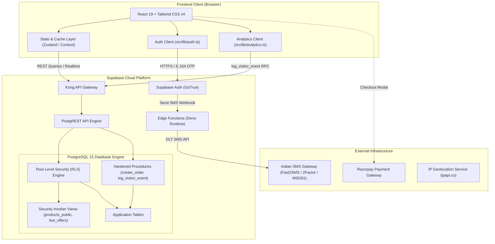
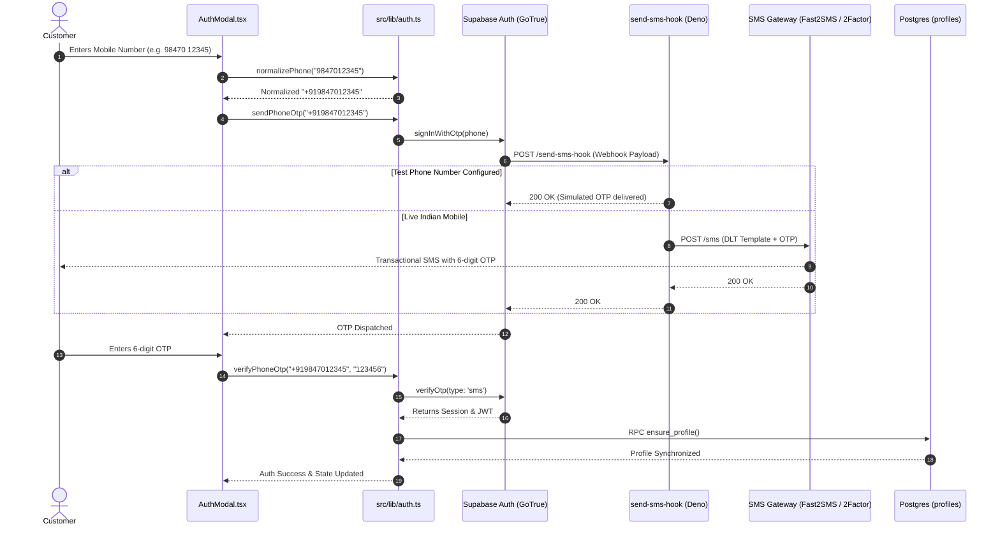
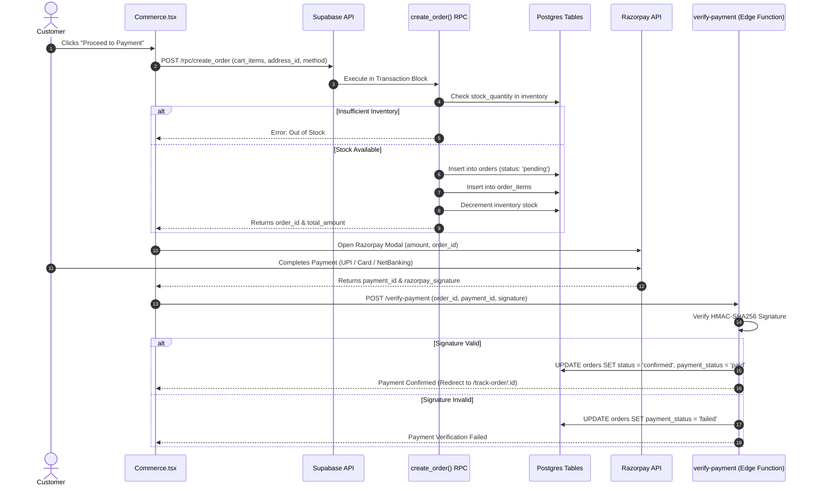
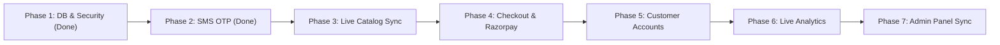

# IT HUB — Technology Store, IT Services & Support

A modern e-commerce, on-site service, and custom PC building platform designed for **IT HUB, Kothamangalam, Kerala** (est. 2011).

The platform is structured around three foundational pillars:
> **SHOP → SERVICE → SUPPORT**, with the **PC Builder** as a guided recommendation engine.

---

## 1. System Overview & Tech Stack

| Domain | Technology / Service | Details & Role |
| :--- | :--- | :--- |
| **Frontend Framework** | React 19 + TypeScript, Vite 8 | High-performance SPA with client-side data routing and lazy-loaded modules |
| **Styling & Design System** | Tailwind CSS v4, Motion, Lenis | Light-mode palette derived from IT HUB brand tokens (`#1a4fd6`, `#ecf1ff`, `#0c2f8a`, `#25D366`) |
| **Backend & Database** | Supabase (PostgreSQL 15+) | Cloud PostgreSQL with Row Level Security (RLS), custom RPCs, and database extensions |
| **Authentication** | Supabase Auth (GoTrue) + SMS Hook | Passwordless mobile OTP authentication (+91 Indian format) with profile reconciliation |
| **SMS Gateway Integration** | Supabase Edge Functions (Deno) | Unified webhook supporting Fast2SMS (DLT/Quick OTP), 2Factor, MSG91, and test numbers |
| **Payment Gateway** | Razorpay (planned/configured) | Indian UPI, debit/credit cards, and net banking with cryptographic webhook verification |
| **Analytics Engine** | Custom privacy-first analytics | In-browser session tracking with server-side ingestion via `log_visitor_event` RPC |

---

## 2. Supabase Implementation & Hardening (Completed & Fixed)

The database schema, security posture, and serverless functions have been hardened according to production standards.

### 2.1. Database Schema & Foreign Key Resolution
- **Canonical Schema**: Defined in [`supabase/schema.sql`](file:///d:/mario/IT%20HUB/ITHUB_WEB/supabase/schema.sql) and [`supabase/migration.sql`](file:///d:/mario/IT%20HUB/ITHUB_WEB/supabase/migration.sql).
- **Relational Integrity**: Complete normalization across 18 core tables (`profiles`, `categories`, `brands`, `products`, `product_specifications`, `inventory`, `offers`, `customer_addresses`, `orders`, `order_items`, `service_requests`, `brand_support`, `pc_builds`, etc.).
- **UUID & Type Alignment**: Resolved historical seed foreign key mismatches by generating consistent, deterministic UUIDs for categories, brands, products, and admin settings.

### 2.2. Critical Security Definer View Remediation
- **The Issue**: Postgres views defined with default `SECURITY DEFINER` semantics bypass Row Level Security (RLS) policies of underlying tables, potentially exposing confidential data to unauthenticated (`anon`) callers.
- **The Fix**:
  - Converted `products_public`, `live_offers`, and `public_coupons` views to:
    ```sql
    WITH (security_invoker = on, security_barrier = true)
    ```
  - **Wholesale Price Protection**: Confidential margin data (`products.cost_price`) is strictly protected. Column-level permissions on `products` explicitly exclude `cost_price` for both `anon` and `authenticated` roles:
    ```sql
    REVOKE ALL ON public.products FROM anon, authenticated;
    GRANT SELECT (id, category_id, brand_id, name, slug, description, short_specs,
                  mrp, our_price, discount_percent, sku, barcode, stock_quantity,
                  low_stock_threshold, is_active, is_featured, is_new, warranty_summary,
                  rating, review_count, primary_image_url, gallery_urls, created_at, updated_at)
    ON public.products TO anon, authenticated;
    ```

### 2.3. RPC Function Hardening & Privilege Separation
- **Read-Only Functions Converted to `SECURITY INVOKER`**:
  - `health_check()`: Verifies database liveness using caller permissions.
  - `check_onsite_warranty(p_pincode, p_location_id)`: Calculates distance against service radius.
  - `validate_coupon(p_code, p_cart_subtotal)`: Evaluates coupon rules without privilege escalation.
- **Administrative Functions Protected**:
  - `is_admin()`: Revoked `EXECUTE` privilege from `anon`. Returns `true` only for authenticated users with role `admin` in `profiles`.
  - `rls_auto_enable()`: Revoked from `anon` and `authenticated`.
- **Hardened Transactional Procedures (`SECURITY DEFINER`)**:
  - `create_order(...)`: Validates `auth.uid()`, enforces atomic inventory checks, reserves stock, creates order records, and returns the generated order UUID.
  - `cancel_order(...)`: Restricts cancellation to the order owner or administrator, reverting reserved inventory.
  - `ensure_profile()`: Safely provisions or updates customer profile rows on first authentication.
  - `log_visitor_event(...)`: Allows client analytics ingestion while restricting direct table write access.
  - **Search Path Protection**: All `SECURITY DEFINER` functions explicitly set `SET search_path = public, pg_temp` to prevent search path hijacking.

### 2.4. Performance & Database Linter Optimizations
- **Fixed 34 `auth_rls_initplan` Warnings**:
  - Standard `auth.uid()` calls in RLS policies cause Postgres to re-evaluate user identity once per row during table scans.
  - Wrapped all occurrences with `(select auth.uid())`, enabling Postgres to evaluate user identity once per query as a cached `InitPlan` (5x–10x scan speedup at scale).
- **Fixed 100+ `multiple_permissive_policies` Warnings**:
  - Eliminated policy expression duplication. Policies without explicit `TO role` clauses defaulted to `TO public`, executing redundant `OR` conditions.
  - Separated public storefront reads (`FOR SELECT TO public`) from admin modifications (`FOR INSERT/UPDATE/DELETE TO authenticated USING (is_admin())`). Customer write policies now cleanly unify owner checks and administrative overrides.
- **Index Cleanup & Optimization**:
  - **Dropped Duplicate Index**: Removed redundant `brand_support_category_fk_idx` on `public.brand_support(category)`.
  - **Added 18 Missing Foreign Key Covering Indexes**: Created indexes on unindexed foreign keys (`parent_id`, `address_id`, `coupon_id`, `offer_id`, `location_id`, etc.) to eliminate sequential table scans during relational joins and cascade deletes.

### 2.5. SMS OTP Authentication & Indian Gateway Hook (Phase 2)
- **Client Auth Library**: [`src/lib/auth.ts`](file:///d:/mario/IT%20HUB/ITHUB_WEB/src/lib/auth.ts) handles Indian mobile numbers with automatic E.164 formatting (`+91`), OTP transmission, code verification, session persistence, and profile reconciliation.
- **Edge Function Hook**: [`supabase/functions/send-sms-hook/index.ts`](file:///d:/mario/IT%20HUB/ITHUB_WEB/supabase/functions/send-sms-hook/index.ts) serves as Supabase Auth's SMS Provider Webhook.
  - Native multi-provider support: **Fast2SMS** (DLT Template & Quick OTP), **2Factor**, and **MSG91**.
  - Integrated support for Supabase Test Phone Numbers during development.
  - Verified with 96/96 edge function unit and security tests.

---

## 3. System Architectures

### 3.1. Overall System Architecture



---

### 3.2. Database Security & Access Architecture

```mermaid
flowchart LR
    subgraph Roles["Postgres Caller Roles"]
        Anon["anon (Guest Visitor)"]
        Auth["authenticated (Logged-in Customer)"]
        AdminRole["authenticated (Admin User)"]
    end

    subgraph PresentationLayer["Public Presentation Layer"]
        PubViews["Views with security_invoker = on\n(products_public, live_offers, public_coupons)"]
        ColMask["Column Grants on products\n(cost_price EXCLUDED)"]
    end

    subgraph RLSBoundary["Row Level Security Boundary"]
        InitPlan["InitPlan Cache: (select auth.uid())"]
        CustTables["Customer Tables\n(orders, customer_addresses, pc_builds)"]
        AdminTables["Admin & Setting Tables\n(store_settings, visitor_sessions)"]
    end

    subgraph ExecutionLayer["Privileged Execution Layer"]
        RPCDefiner["SECURITY DEFINER RPCs\n(create_order, cancel_order, log_visitor_event)\nsearch_path = public, pg_temp"]
        RawMutations["Direct Table INSERT/UPDATE/DELETE"]
    end

    Anon -->|Read Catalog| PubViews
    PubViews --> ColMask
    Auth -->|Read Catalog| PubViews
    Auth -->|Read Own Records| InitPlan
    InitPlan --> CustTables
    AdminRole -->|Full Read/Write via is_admin()| CustTables
    AdminRole -->|Full Read/Write via is_admin()| AdminTables

    Auth -->|Place Orders| RPCDefiner
    Anon -->|Log Analytics| RPCDefiner
    RPCDefiner --> RawMutations
```

---

### 3.3. Authentication & SMS OTP Flow



---

### 3.4. Order Creation & Razorpay Settlement Flow



---

## 4. Implementation Roadmap (Phases 3 through 7)



### Phase 3 — Live Catalog & Inventory Synchronization
- [ ] **Task 3.1: Connect Storefront Catalog to `products_public`**:
  - Replace static `catalog.ts` imports in [`src/pages/Products.tsx`](file:///d:/mario/IT%20HUB/ITHUB_WEB/src/pages/Products.tsx) with queries to the Supabase `products_public` view.
  - Support server-side filtering, category narrowing, brand selection, and pagination.
- [ ] **Task 3.2: Connect Active Promotions & Coupons**:
  - Fetch real-time banner discounts and promotional rules from `live_offers` and `public_coupons`.
- [ ] **Task 3.3: Realtime Stock Subscription**:
  - Wire Supabase Realtime (`postgres_changes` on `inventory`) to display live availability badges ("In Stock", "Only 2 left", "Out of Stock") on product pages.
- [ ] **Task 3.4: Offline Fallback & Hydration Cache**:
  - Cache fetched catalog in memory/IndexedDB for instant route transitions and resilience during network drops.

### Phase 4 — End-to-End Checkout & Razorpay Settlement Integration
- [ ] **Task 4.1: Connect Cart to `create_order` RPC**:
  - Wire [`src/pages/Commerce.tsx`](file:///d:/mario/IT%20HUB/ITHUB_WEB/src/pages/Commerce.tsx) checkout action to execute `create_order` with the user's active cart items and selected shipping address.
- [ ] **Task 4.2: Razorpay Client Integration**:
  - Inject Razorpay Checkout JavaScript SDK with IT HUB branding tokens (`#1a4fd6`).
  - Pass order details, customer phone, and prefill metadata.
- [ ] **Task 4.3: Edge Function Payment Verification**:
  - Deploy `verify-payment` Edge Function to securely calculate HMAC SHA-256 signatures against the `RAZORPAY_KEY_SECRET`.
  - Update `orders` record atomically upon successful payment verification.
- [ ] **Task 4.4: Live Order Tracking**:
  - Connect `/track-order/:id` to fetch live status (`placed` → `confirmed` → `packed` → `shipped` → `delivered`).

### Phase 5 — Customer Account & Profile Management
- [ ] **Task 5.1: Address Book Management**:
  - Allow customers to manage multiple shipping and billing addresses (`customer_addresses`) in [`src/pages/Account.tsx`](file:///d:/mario/IT%20HUB/ITHUB_WEB/src/pages/Account.tsx).
- [ ] **Task 5.2: Cloud PC Builds Synchronization**:
  - Persist customer custom PC configurations (`pc_builds`) to Supabase under their authenticated `user_id`.
- [ ] **Task 5.3: Service Booking Management**:
  - Connect the service booking wizard in [`src/pages/Services.tsx`](file:///d:/mario/IT%20HUB/ITHUB_WEB/src/pages/Services.tsx) to insert into `service_requests` and enable real-time tracking at `/track-service/:id`.

### Phase 6 — Live Visitor Analytics Ingestion
- [ ] **Task 6.1: Client Analytics Ingestion**:
  - Update [`src/lib/analytics.ts`](file:///d:/mario/IT%20HUB/ITHUB_WEB/src/lib/analytics.ts) to push session creation and tracking events to the database using `log_visitor_event` RPC.
- [ ] **Task 6.2: Privacy & Anonymization Compliance**:
  - Respect IP masking settings and user consent flags prior to transmission.
- [ ] **Task 6.3: Scheduled Data Retention (pg_cron)**:
  - Configure automated execution of `purge_visitor_data()` to enforce data retention limits (e.g. 30/90 days).

### Phase 7 — Admin Dashboard Database Integration
- [ ] **Task 7.1: Catalog & Inventory Management**:
  - Connect [`src/pages/Admin.tsx`](file:///d:/mario/IT%20HUB/ITHUB_WEB/src/pages/Admin.tsx) products tab, bulk CSV/XLSX import, and stock adjustments directly to `products` and `inventory`.
- [ ] **Task 7.2: Order Management & Fulfillment**:
  - Enable live status changes (`confirmed`, `shipped`, `delivered`), cancellation management, and invoice generation.
- [ ] **Task 7.3: Brand Support Verification**:
  - Connect the brand support directory and official verification history logging.
- [ ] **Task 7.4: Store Configuration & Service Areas**:
  - Allow administrators to manage on-site service radius, PIN codes (`pincode_areas`), and official store contact settings.

---

## 5. Development & Verification Guide

### 5.1. Running the Local Environment

```bash
# Install dependencies
pnpm install

# Start Vite development server
pnpm dev

# Build production bundle
pnpm build

# Run TypeScript and test suite
pnpm test
```

### 5.2. Edge Function Deployment

```bash
# Deploy SMS Hook to Supabase
supabase functions deploy send-sms-hook --no-verify-jwt

# Set Secrets on Supabase
supabase secrets set SMS_GATEWAY_PROVIDER=fast2sms
supabase secrets set FAST2SMS_API_KEY=your_key_here
supabase secrets set FAST2SMS_SENDER_ID=ITHUBK
supabase secrets set FAST2SMS_DLT_TEMPLATE_ID=your_dlt_template_id
```

---

## 6. Directory Layout

```text
src/
├── main.tsx                 React entrypoint & CSS setup
├── app/
│   ├── App.tsx              Router and lazy routes
│   └── store.tsx            Client state & UI notification store
├── components/
│   ├── Layout.tsx           Header, navigation mega-menu, footer
│   ├── AuthModal.tsx        Indian mobile phone + SMS OTP dialog
│   ├── ProductCard.tsx      Product card with MRP, our price & stock
│   ├── WarrantyCheck.tsx    On-site service PIN check
│   └── ui.tsx               Design system primitives
├── lib/
│   ├── auth.ts              Supabase Auth client & E.164 phone utilities
│   ├── supabase.ts          Supabase client initialization
│   └── analytics.ts         Visitor session & event tracking client
├── pages/
│   ├── Home.tsx             Landing page
│   ├── Products.tsx         Product catalog and detail pages
│   ├── Commerce.tsx         Cart, checkout, and tracking
│   ├── Services.tsx         Services landing and booking wizard
│   ├── Builder.tsx          Smart PC Builder & Expert Mode
│   ├── Support.tsx          Help & Support directory
│   ├── Account.tsx          Customer account dashboard
│   ├── Admin.tsx            Admin management dashboard
│   └── AdminAnalytics.tsx   Visitor & sales analytics
supabase/
├── schema.sql               Canonical database schema & RLS policies
├── migration.sql            Incremental migration and hardening scripts
└── functions/
    └── send-sms-hook/       Deno edge function for SMS OTP delivery
```
