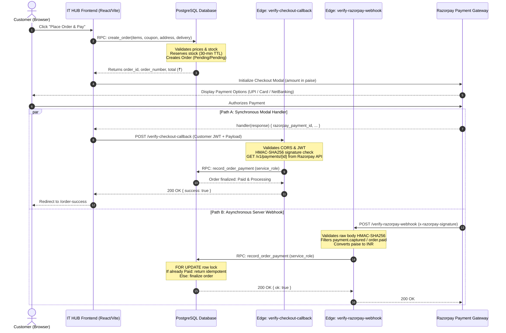
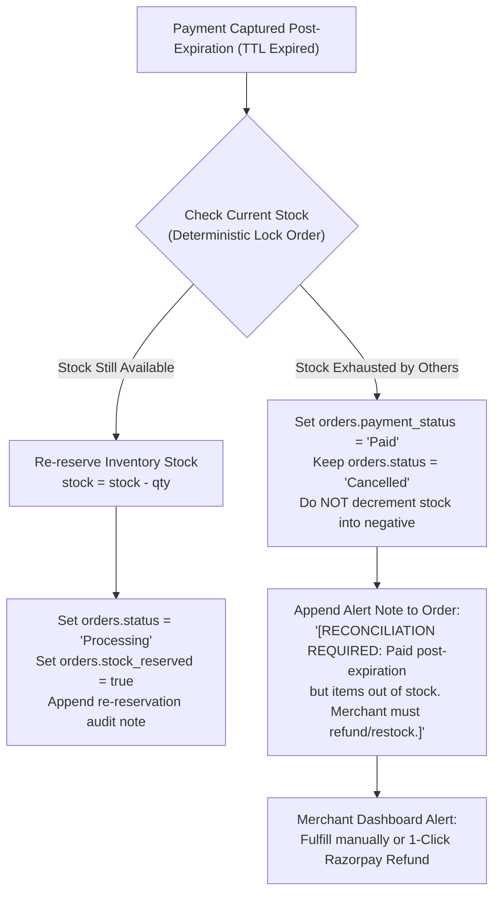

# IT HUB — High-Level Payment Architecture & Transaction Security Guide

This document specifies the end-to-end payment processing architecture for **IT HUB** (Kerala, India), detailing the transaction lifecycle, dual-verification pipeline, Razorpay gateway integration, stock reservation rules, and late-payment reconciliation mechanics.

---

## 1. Executive Summary & Zero-Trust Threat Model

In e-commerce systems, checkout and payment processing are the primary targets for fraud, state manipulation, and concurrency exploits. The IT HUB payment system is designed with a **zero-trust boundary**:

1. **Client Price Tampering**: Frontend JavaScript cannot dictate the cost of items, coupon discounts, shipping charges, or the final order total. Pricing is computed strictly on the PostgreSQL server using authoritative catalogue tables.
2. **Payment Spoofing**: A browser client cannot set an order's status to `Paid`. Direct execution of [`record_order_payment`](file:///d:/mario/IT%20HUB/ITHUB_WEB/supabase/schema.sql#L1604) is revoked from `public`, `anon`, and `authenticated` roles. Only trusted Supabase Edge Functions with `service_role` credentials can record payments.
3. **Race Conditions & Webhook Clashes**: Razorpay payment confirmations can arrive via client modal handlers and asynchronous server webhooks concurrently. Database-level pessimistic locking (`FOR UPDATE`) and idempotency checks guarantee that duplicate deliveries never double-deduct inventory or double-count coupons.
4. **Currency & Unit Isolation**: PostgreSQL stores money in Indian Rupees (`numeric(12, 2)`), whereas Razorpay operates in integer **paise** ($1\text{ INR} = 100\text{ paise}$). Conversion and rounding boundaries are enforced strictly inside Edge Functions (`Math.round(total * 100)`).
5. **Late UPI Payments & Oversubscription**: If a customer completes a UPI payment after their 30-minute reservation window expires, the system avoids negative inventory through deterministic stock checks and automated reconciliation alerts.

---

## 2. High-Level Transaction Flow

The transaction lifecycle operates across two verification paths:



---

## 3. Step-by-Step Checkout & Order Initialization

### 1. Order Creation (`create_order` RPC)

When the customer clicks "Place Order":

- **RPC Invocation**: The frontend calls [`create_order`](file:///d:/mario/IT%20HUB/ITHUB_WEB/supabase/schema.sql#L1435) passing an array of `{ product_id, quantity }`, delivery method, address ID, and optional coupon code.
- **Server-Side Validation**:
  - Validates that products exist, are active, and have sufficient stock in `inventory`.
  - Calculates subtotal from `products.sale_price` (or `regular_price`).
  - Validates coupon eligibility (valid dates, minimum order value, global limit, single-use per customer, and active checkout lock).
  - Calculates shipping fee: ₹0.00 for Store Pickup, ₹99.00 flat fee for Home Delivery across Kerala.
- **Atomic Stock Deduction**:
  - Deducts `quantity` from `inventory.stock` immediately.
  - Sets `orders.expires_at = now() + interval '30 minutes'` and `orders.stock_reserved = true`.
  - Records an immutable price snapshot in `order_items` (preserving captured unit prices forever).
  - Returns `order_id`, `order_number`, and authoritative `total` in Rupees.

### 2. Razorpay Order Binding

Before loading the Razorpay modal, the storefront or checkout edge worker creates a gateway order:

- Converts total to paise: $\text{amount\_paise} = \text{round}(\text{total} \times 100)$.
- Creates Razorpay Order with currency `'INR'`.
- Calls [`attach_razorpay_order_id`](file:///d:/mario/IT%20HUB/ITHUB_WEB/supabase/schema.sql#L1562) to bind the gateway order ID to the pending database order row.

---

## 4. Dual-Verification Pipelines

### Path A: Synchronous Checkout Callback (`verify-checkout-callback`)

Located at [`supabase/functions/verify-checkout-callback/index.ts`](file:///d:/mario/IT%20HUB/ITHUB_WEB/supabase/functions/verify-checkout-callback/index.ts):

1. **Origin & CORS Validation**:
   - Inspects the HTTP `Origin` header against `STOREFRONT_ORIGIN`.
   - Fails closed: wildcard `*` origins and unauthorized domains are rejected.
2. **User Authentication**:
   - Requires valid Supabase Auth JWT in `Authorization: Bearer <token>`.
   - Verifies the user's identity before processing payment data.
3. **Cryptographic Signature Verification**:
   - Computes HMAC-SHA256 over `${razorpay_order_id}|${razorpay_payment_id}` using `RAZORPAY_KEY_SECRET`.
   - Uses constant-time byte comparison ([`constantTimeCompare`](file:///d:/mario/IT%20HUB/ITHUB_WEB/supabase/functions/verify-checkout-callback/index.ts#L148)) to defend against timing attacks.
4. **Authoritative Gateway Verification**:
   - Directly calls Razorpay REST API: `GET https://api.razorpay.com/v1/payments/{payment_id}`.
   - Verifies that `status === 'captured'`, `currency === 'INR'`, and `amount` matches the internal order.
5. **Database Finalization**:
   - Calls [`record_order_payment`](file:///d:/mario/IT%20HUB/ITHUB_WEB/supabase/schema.sql#L1604) using `service_role`.

### Path B: Asynchronous Server Webhook (`verify-razorpay-webhook`)

Located at [`supabase/functions/verify-razorpay-webhook/index.ts`](file:///d:/mario/IT%20HUB/ITHUB_WEB/supabase/functions/verify-razorpay-webhook/index.ts):

1. **Payload Integrity**:
   - Reads the raw HTTP request body text (`req.text()`).
   - Computes HMAC-SHA256 over raw body bytes using `RAZORPAY_WEBHOOK_SECRET`.
   - Verifies header `x-razorpay-signature` using timing-safe comparison.
2. **Event Filtering**:
   - Processes only `payment.captured` and `order.paid` events.
   - Unrelated events (e.g. `refund.processed`, `settlement.created`) return HTTP 200 `{ ok: true, ignored_event: event }` immediately.
3. **Data Extraction & Unit Conversion**:
   - Converts paise to INR: $\text{amount\_inr} = \frac{\text{payment.amount}}{100.0}$.
   - Extracts internal `order_id` UUID from payment notes.
4. **Database Finalization**:
   - Calls [`record_order_payment`](file:///d:/mario/IT%20HUB/ITHUB_WEB/supabase/schema.sql#L1604) using `service_role`.

---

## 5. Database Settlement Engine: `record_order_payment`

The database stored procedure [`record_order_payment`](file:///d:/mario/IT%20HUB/ITHUB_WEB/supabase/schema.sql#L1604) provides transactional guarantees:

### 1. Security Definer & Privilege Lockdown

```sql
REVOKE ALL ON FUNCTION record_order_payment(uuid, text, text, text, numeric, text)
  FROM public, anon, authenticated;
GRANT EXECUTE ON FUNCTION record_order_payment(uuid, text, text, text, numeric, text)
  TO service_role;
```

Direct access is blocked for all public and client roles.

### 2. Pessimistic Locking & Idempotency

- Acquires a row lock on the order: `SELECT * FROM orders WHERE ... FOR UPDATE`.
- **Duplicate Callback/Webhook Handling**:
  - If `payment_status == 'Paid'` with matching `razorpay_payment_id`:
    Returns `{ ok: true, idempotent: true }` without touching inventory or coupons.
  - If `payment_status == 'Paid'` with a _different_ payment ID:
    Raises an exception (`Order is already marked as Paid with different payment ID`).

### 3. Exact Amount Verification

```sql
if round(p_amount_paid, 2) <> round(v_order.total, 2) then
  raise exception 'Payment amount mismatch: Expected ₹%, Received ₹%', v_order.total, p_amount_paid;
end if;
```

Ensures that partial or manipulated payments are rejected.

### 4. Atomic Coupon Redemption

- Acquires `FOR UPDATE` lock on the coupon row.
- Inserts usage into `coupon_usages` (`ON CONFLICT (coupon_id, customer_id) DO NOTHING`).
- Increments `coupons.times_used`.
- If a quota conflict or duplicate usage occurred in the interim, sets a `[COUPON CONFLICT ALERT]` in order notes for manual billing adjustment without failing the customer's paid order.

---

## 6. The 30-Minute Reservation & Late-Payment Edge Cases

### Stock Reservation TTL

1. Every order created via `create_order` reserves physical stock for **30 minutes**.
2. A background worker periodically invokes [`cleanup_expired_orders`](file:///d:/mario/IT%20HUB/ITHUB_WEB/supabase/schema.sql#L1928), which identifies unpaid pending checkouts past `expires_at`:
   - Uses `FOR UPDATE SKIP LOCKED` to prevent contention with active checkouts.
   - Restores reserved stock back to `inventory.stock`.
   - Sets `orders.status = 'Cancelled'` and `orders.stock_reserved = false`.

### What happens if payment succeeds after expiration?

If a customer leaves a UPI app open and authorizes payment after 35 minutes:



This guarantees that:

- **No negative stock** ever occurs.
- The customer's money is accounted for and tied to their order record.
- The merchant is immediately alerted to either back-order the stock or trigger a Razorpay refund.

---

## 7. Order Cancellation & Failure Workflows

| Scenario                               | Trigger / Actor                   | Method                                                                                    | Outcome                                                                                                 |
| :------------------------------------- | :-------------------------------- | :---------------------------------------------------------------------------------------- | :------------------------------------------------------------------------------------------------------ |
| **Payment Failed / Declined**          | Razorpay Webhook or Edge Callback | [`record_payment_failure`](file:///d:/mario/IT%20HUB/ITHUB_WEB/supabase/schema.sql#L1829) | Sets `payment_status = 'Failed'`, `status = 'Cancelled'`, and atomically restores stock to `inventory`. |
| **Unpaid Order Cancelled by Customer** | Customer Profile / Order View     | [`cancel_order`](file:///d:/mario/IT%20HUB/ITHUB_WEB/supabase/schema.sql#L1876)           | Allowed only if `status == 'Pending'` and `payment_status != 'Paid'`. Restores stock idempotently.      |
| **Paid Order Cancellation Request**    | Customer                          | Merchant Return / Refund Flow                                                             | Direct customer cancellation blocked. Customer must contact support; merchant initiates return/refund.  |
| **Admin Order Cancellation**           | Store Administrator               | [`cancel_order`](file:///d:/mario/IT%20HUB/ITHUB_WEB/supabase/schema.sql#L1876)           | Restores stock (if reserved). For paid orders, admin initiates gateway refund via Razorpay dashboard.   |

---

## 8. Environment Secrets & Deployment Guide

Configure the following secrets in your Supabase project settings (`supabase secrets set`):

| Variable Name               | Environment             | Description                                                                |
| :-------------------------- | :---------------------- | :------------------------------------------------------------------------- |
| `SUPABASE_URL`              | Edge Functions          | Your Supabase project API URL.                                             |
| `SUPABASE_SERVICE_ROLE_KEY` | Edge Functions          | Privileged service key (never exposed to client browser).                  |
| `SUPABASE_ANON_KEY`         | Edge Functions & Client | Public anon key for client JWT validation.                                 |
| `RAZORPAY_KEY_ID`           | Edge Functions & Client | Public Razorpay key ID (`rzp_test_...` or `rzp_live_...`).                 |
| `RAZORPAY_KEY_SECRET`       | Edge Functions          | Private Razorpay key secret for signature verification.                    |
| `RAZORPAY_WEBHOOK_SECRET`   | Edge Functions          | Webhook secret configured in Razorpay Webhook Dashboard.                   |
| `STOREFRONT_ORIGIN`         | Edge Functions          | Comma-separated allowed frontend origins (e.g. `https://ithub.com`).       |
| `APP_ENV`                   | Edge Functions          | `production` or `development` (enables localhost only when `development`). |

---

## 9. Automated Test Verification

All payment verification logic and security boundaries are covered by unit and integration tests:

```bash
npm run test:edge
```

**Test Suite Coverage Summary**:

- `verify-checkout-callback.test.ts` (43 tests): Validates CORS allowlists, missing/invalid Bearer JWTs, HMAC-SHA256 signature verification, constant-time comparisons, and API status checking.
- `verify-razorpay-webhook.test.ts` (19 tests): Validates raw body HMAC signature checking, event filtering, paise-to-INR conversions, and notes extraction.
- `security-fixes-audit.test.ts` (18 tests): Validates database RPC privilege lockouts, negative inventory protection, and coupon conflict flags.
- **Total: 80 tests passing (100% success rate)**.
