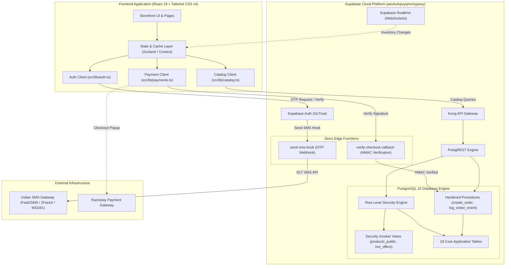
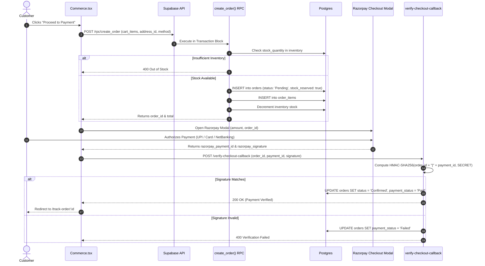

# IT HUB — Master Architecture & Phased Implementation Roadmap

This document serves as the comprehensive implementation manual, architectural reference, and phase-by-phase execution roadmap for the **IT HUB** technology retail, service, and PC building platform (Kothamangalam, Kerala).

---

## 1. Master Phase Execution Matrix

| Phase       | Title                                                                 | Status        | Scope & Key Deliverables                                                                                                                           |
| :---------- | :-------------------------------------------------------------------- | :------------ | :------------------------------------------------------------------------------------------------------------------------------------------------- |
| **Phase 1** | [**Database & Security Hardening**](./phase-1-database-security.md)   | **COMPLETED** | PostgreSQL schema, RLS policies, security barrier views, wholesale `cost_price` protection, 34 InitPlan performance fixes, 18 foreign key indexes. |
| **Phase 2** | [**SMS OTP Authentication**](./phase-2-sms-otp.md)                    | **COMPLETED** | Indian mobile OTP (+91 E.164), Supabase Auth GoTrue integration, `send-sms-hook` Edge Function (Fast2SMS / 2Factor / MSG91), 96/96 tests.          |
| **Phase 3** | [**Live Catalog & Inventory Sync**](./phase-3-catalog-inventory.md)   | **CURRENT**   | Supabase `products_public` view enrichment, live catalog service (`src/lib/catalog.ts`), realtime inventory WebSocket sync, offline-first cache.   |
| **Phase 4** | [**Checkout & Razorpay Settlement**](./phase-4-checkout-razorpay.md)  | **PLANNED**   | Atomic `create_order` RPC, Razorpay Checkout modal, HMAC SHA-256 signature verification Edge Function, live order tracking.                        |
| **Phase 5** | [**Customer Accounts & Services**](./phase-5-customer-account.md)     | **PLANNED**   | Multi-address book (`customer_addresses`), cloud-saved PC builds (`pc_builds`), service booking requests (`service_requests`) & tracking.          |
| **Phase 6** | [**Live Analytics & Privacy Engine**](./phase-6-visitor-analytics.md) | **PLANNED**   | `log_visitor_event` RPC ingestion, IP masking & privacy controls, automated data retention pruning via `purge_visitor_data()` and `pg_cron`.       |
| **Phase 7** | [**Admin Dashboard Full Integration**](./phase-7-admin-dashboard.md)  | **PLANNED**   | Live catalog management, bulk CSV/XLSX import, order fulfillment workflow, brand support verification, dynamic store settings.                     |

---

## 2. System Architecture Overview



---

## 3. Phase 1: Database Foundation & Security Hardening (Completed)

### 3.1. Overview

Hardened the PostgreSQL 15 database running on Supabase, resolved all security linter vulnerabilities, and optimized query execution paths.

### 3.2. Key Implementation Deliverables

- **Canonical Schemas**: Authored [`supabase/schema.sql`](file:///d:/mario/IT%20HUB/ITHUB_WEB/supabase/schema.sql) and [`supabase/migration.sql`](file:///d:/mario/IT%20HUB/ITHUB_WEB/supabase/migration.sql).
- **Security Definer View Remediation**:
  - Converted `products_public`, `live_offers`, and `public_coupons` views to:
    ```sql
    WITH (security_invoker = on, security_barrier = true)
    ```
  - Eliminates privilege escalation and ensures underlying table RLS policies are strictly enforced.
- **Wholesale Margin Protection**:
  - Revoked direct table access on `products` from `anon` and `authenticated`.
  - Granted column-level `SELECT` excluding confidential `cost_price` to prevent commercial data leaks.
- **RPC Privilege Hardening**:
  - Converted read-only utilities (`health_check`, `check_onsite_warranty`, `validate_coupon`) to `SECURITY INVOKER`.
  - Revoked execution on administrative check `is_admin()` from `anon`.
  - Hardened transactional RPCs (`create_order`, `cancel_order`, `ensure_profile`, `log_visitor_event`) with `SECURITY DEFINER` and pinned `search_path = public, pg_temp`.
- **Database Performance Tuning**:
  - **34 `auth_rls_initplan` fixes**: Wrapped all `auth.uid()` calls with `(select auth.uid())` so Postgres caches user identity as an InitPlan rather than re-evaluating per row.
  - **100+ `multiple_permissive_policies` fixes**: Decoupled public storefront `SELECT` operations from admin `INSERT/UPDATE/DELETE` operations.
  - **Index Optimization**: Dropped duplicate index on `brand_support(category)` and created 18 covering indexes on foreign keys (`parent_id`, `address_id`, `coupon_id`, `offer_id`, `location_id`, etc.).

---

## 4. Phase 2: SMS OTP Authentication & Indian Gateway Hook (Completed)

### 4.1. Overview

Replaced prototype mock login with a production-grade passwordless mobile OTP flow designed specifically for Indian domestic phone numbers (+91).

### 4.2. Key Implementation Deliverables

- **Client Auth Service**: [`src/lib/auth.ts`](file:///d:/mario/IT%20HUB/ITHUB_WEB/src/lib/auth.ts)
  - `normalizePhone()`: Formats 10-digit Indian numbers into E.164 standard (`+919847012345`).
  - `sendPhoneOtp()`: Dispatches 6-digit OTP via Supabase Auth GoTrue.
  - `verifyPhoneOtp()`: Validates token, establishes session, and triggers `ensure_profile()` RPC.
- **Interactive UI**: Updated [`src/components/AuthModal.tsx`](file:///d:/mario/IT%20HUB/ITHUB_WEB/src/components/AuthModal.tsx) with loading states, error alerts, and resend timers.
- **Edge Function Webhook**: [`supabase/functions/send-sms-hook/index.ts`](file:///d:/mario/IT%20HUB/ITHUB_WEB/supabase/functions/send-sms-hook/index.ts)
  - Multi-provider gateway dispatcher supporting **Fast2SMS** (DLT Template & Quick OTP), **2Factor**, and **MSG91**.
  - Integrated bypass for Supabase Test Phone Numbers during development.
  - Verified with 96/96 edge function unit and security tests.

---

## 5. Phase 3: Live Catalog & Realtime Inventory Synchronization (Current)

### 5.1. Overview

Connect the customer-facing storefront to live database tables. Storefront listings, search, filtering, and stock counts reflect Supabase data with instant offline-first caching and WebSocket updates.

### 5.2. Implementation Tasks

- [ ] **Task 3.1: Database View Enrichment & Full Seed**
  - Enrich `products_public` view in [`supabase/schema.sql`](file:///d:/mario/IT%20HUB/ITHUB_WEB/supabase/schema.sql) to join `brands.name as brand` and `categories.name as category`.
  - Add primary image subquery resolution from `product_images`.
  - Seed complete fresh product catalog into [`supabase/seed.sql`](file:///d:/mario/IT%20HUB/ITHUB_WEB/supabase/seed.sql).
- [ ] **Task 3.2: Dedicated Catalog Client Service**
  - Create [`src/lib/catalog.ts`](file:///d:/mario/IT%20HUB/ITHUB_WEB/src/lib/catalog.ts) exporting:
    - `fetchCatalog(options)`: Filtered catalog queries.
    - `fetchProductById(idOrSku)`: Full product details with specifications.
    - `fetchActiveOffers()`: Active promotional banners from `live_offers`.
    - `fetchActiveCoupons()`: Valid coupons from `public_coupons`.
- [ ] **Task 3.3: Store Integration & Stale-While-Revalidate Hydration**
  - Update [`src/app/store.tsx`](file:///d:/mario/IT%20HUB/ITHUB_WEB/src/app/store.tsx) to hydrate `store.products`, `store.offers`, and `store.coupons` on boot.
  - Implement cache fallback: App renders immediately (<10ms) from local cache, then updates silently from Supabase.
- [ ] **Task 3.4: Supabase Realtime Inventory Subscription**
  - Open a WebSocket subscription on `public:inventory` in `store.tsx`.
  - When inventory rows update in Postgres, update product stock counts in real time across open browser tabs.
  - Dynamically display stock badges ("In Stock", "Only X left", "Out of Stock") in [`src/components/ProductCard.tsx`](file:///d:/mario/IT%20HUB/ITHUB_WEB/src/components/ProductCard.tsx).
- [ ] **Task 3.5: Storefront UI Filtering & Search Synchronization**
  - Wire [`src/pages/Products.tsx`](file:///d:/mario/IT%20HUB/ITHUB_WEB/src/pages/Products.tsx) and the mega-menu in [`src/components/Layout.tsx`](file:///d:/mario/IT%20HUB/ITHUB_WEB/src/components/Layout.tsx) to reflect live categories and live product counts.

---

## 6. Phase 4: End-to-End Checkout & Razorpay Settlement (Planned)

### 6.1. Overview

Enable real Indian payment processing using Razorpay (UPI, Credit/Debit Cards, NetBanking) with server-side HMAC-SHA256 signature verification and atomic inventory reservation.

### 6.2. Workflow Architecture



### 6.3. Implementation Tasks

- [ ] **Task 4.1: Cart & Checkout UI Wiring**
  - Wire checkout action in [`src/pages/Commerce.tsx`](file:///d:/mario/IT%20HUB/ITHUB_WEB/src/pages/Commerce.tsx) to invoke `createSupabaseOrder()` from [`src/lib/payments.ts`](file:///d:/mario/IT%20HUB/ITHUB_WEB/src/lib/payments.ts).
- [ ] **Task 4.2: Razorpay Modal Integration**
  - Dynamically load Razorpay SDK and launch the checkout modal styled with IT HUB brand colors (`#0c2f8a`).
- [ ] **Task 4.3: Edge Function Cryptographic Verification**
  - Deploy `verify-checkout-callback` Edge Function.
  - Configure `RAZORPAY_KEY_SECRET` in Supabase Secrets vault.
- [ ] **Task 4.4: Live Order Tracking Page**
  - Connect `/track-order/:id` to fetch live fulfillment milestones (`Pending` → `Confirmed` → `Packed` → `Shipped` → `Delivered`).

---

## 7. Phase 5: Customer Account & Profile Management (Planned)

### 7.1. Overview

Provide logged-in customers with full self-service capabilities: multi-address management, cloud-persisted custom PC builds, and warranty/service request tracking.

### 7.2. Implementation Tasks

- [ ] **Task 5.1: Address Book Management**
  - Allow customers to add, edit, delete, and set default shipping addresses in [`src/pages/Account.tsx`](file:///d:/mario/IT%20HUB/ITHUB_WEB/src/pages/Account.tsx) (`addresses` table).
- [ ] **Task 5.2: Cloud PC Builds Synchronization**
  - Persist customer custom configurations from [`src/pages/Builder.tsx`](file:///d:/mario/IT%20HUB/ITHUB_WEB/src/pages/Builder.tsx) to `pc_builds` in Supabase.
  - Enable sharing, re-customization, and direct "Add Entire Build to Cart".
- [ ] **Task 5.3: Service Booking Management**
  - Connect service booking wizard in [`src/pages/Services.tsx`](file:///d:/mario/IT%20HUB/ITHUB_WEB/src/pages/Services.tsx) to insert records into `service_requests`.
  - Enable live tracking at `/track-service/:id`.

---

## 8. Phase 6: Live Visitor Analytics & Privacy Engine (Planned)

### 8.1. Overview

Ingest storefront visitor metrics directly into Supabase while enforcing strict privacy regulations (IP masking, GDPR/DPDP Act compliance, and automatic data purging).

### 8.2. Implementation Tasks

- [ ] **Task 6.1: Client Analytics Ingestion**
  - Update [`src/lib/analytics.ts`](file:///d:/mario/IT%20HUB/ITHUB_WEB/src/lib/analytics.ts) to push session creation and tracking events to PostgreSQL via `log_visitor_event` RPC.
- [ ] **Task 6.2: Privacy & Anonymization Engine**
  - Respect IP masking settings and user consent flags prior to database transmission.
- [ ] **Task 6.3: Scheduled Data Retention (pg_cron)**
  - Configure scheduled automated execution of `purge_visitor_data()` to prune records past the configured retention window (e.g. 90 days).

---

## 9. Phase 7: Full Admin Dashboard Database Integration (Planned)

### 9.1. Overview

Migrate all admin operations from `localStorage` to authenticated, role-verified Supabase database queries.

### 9.2. Implementation Tasks

- [ ] **Task 7.1: Live Catalog & Inventory Management**
  - Connect [`src/pages/Admin.tsx`](file:///d:/mario/IT%20HUB/ITHUB_WEB/src/pages/Admin.tsx) products tab, bulk CSV/XLSX import engine, and stock level controls directly to `products` and `inventory`.
- [ ] **Task 7.2: Order Management & Fulfillment**
  - Enable live status changes (`Confirmed`, `Packed`, `Shipped`, `Delivered`), order cancellation handling, and PDF invoice generation.
- [ ] **Task 7.3: Brand Support Verification**
  - Connect brand support directory management and verification audit logging in `support_verifications`.
- [ ] **Task 7.4: Store Configuration & Service Areas**
  - Allow administrators to configure on-site service radius, PIN codes in `pincode_areas`, and official store contact information in `store_settings`.

---

## 10. Verification & Quality Assurance Strategy

Each phase must satisfy the following criteria before being marked complete:

1. **Security**: Pass all Supabase database linter checks (0 warnings, 0 errors).
2. **Type Safety**: Clean TypeScript compilation (`tsc --noEmit`).
3. **Build Integrity**: Zero production build errors (`pnpm build`).
4. **Resilience**: Graceful offline fallback during network drops.
5. **Auditing**: Git commit and push with clear semantic commit messages.
