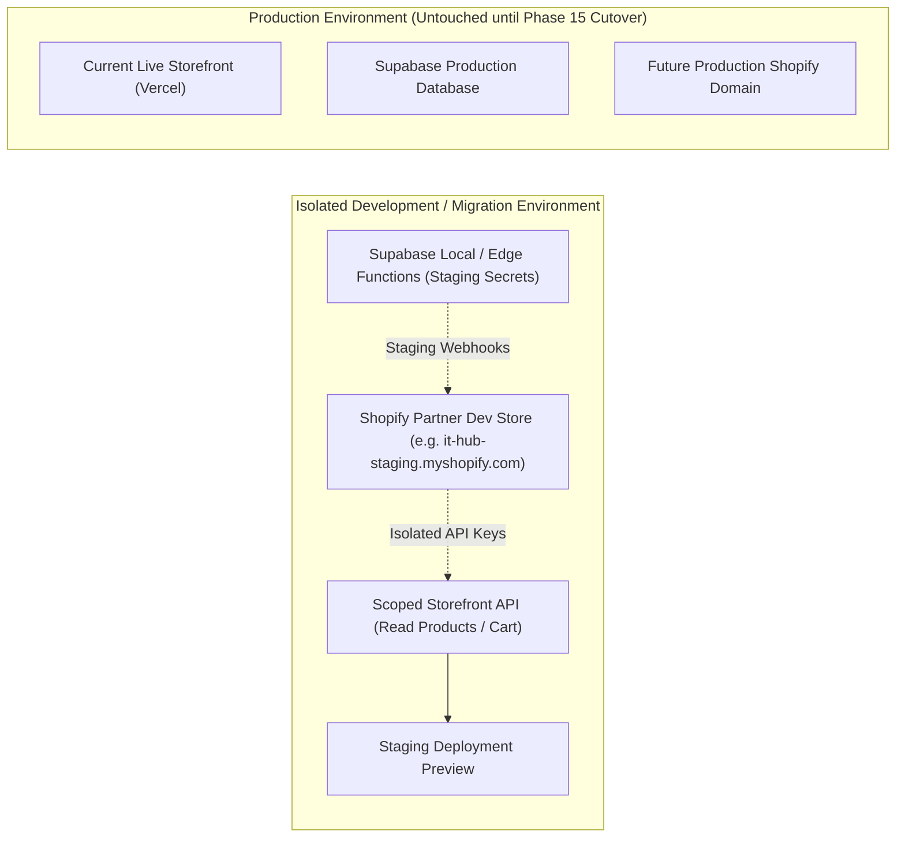
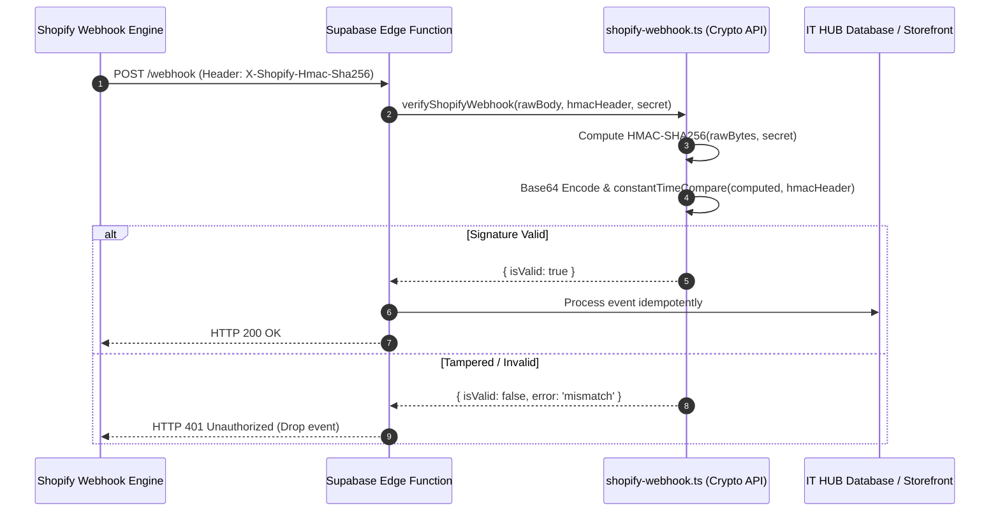

# IT HUB — Phase 2: Isolated Shopify Environment & Security Configuration

**Document Version:** 1.0.0  
**Date:** October 22, 2026  
**Target Launch Date:** November 8, 2026 (17 Calendar Days Remaining)  
**Integration Target:** [`migration/shopify-integration`](https://github.com/shawdi1557/IT-HUB/tree/migration/shopify-integration)  
**Working Branch:** `PH-2`  
**Test Suite Status:** **184 of 184 Passing** across 11 test suites  

---

## 1. Environment Isolation & Separation Strategy

To ensure zero risk to existing operations and prevent accidental test data pollution:

### Environment Rules Enforced:
1. **Zero Credential Sharing**: Development store API keys and production API keys are strictly separated.
2. **Strict Secret Isolation**:
   - Browser client reads **only** public keys prefixed with `VITE_` (`VITE_SHOPIFY_STORE_DOMAIN`, `VITE_SHOPIFY_STOREFRONT_ACCESS_TOKEN`).
   - Privileged Admin API tokens (`shpat_...`) and webhook secrets (`SHOPIFY_WEBHOOK_SECRET`) reside exclusively in serverless Edge Function environments and are never bundled into the client build.
3. **Automated Leak Guard**: [`src/lib/shopify.ts`](file:///d:/mario/IT%20HUB/ITHUB_WEB/src/lib/shopify.ts) includes runtime token detection that aborts and logs an error if an Admin token (`shpat_` / `shpca_`) is accidentally configured in the public storefront variable.

---

## 2. Store Business Profile, Currency & Locations

| Attribute | Specification | Configuration Location |
|---|---|---|
| **Store Name** | IT HUB — Complete Tech Experience | Shopify Admin -> General Settings |
| **Primary Region** | Kerala, India (`IN`) | Shopify Admin -> Store Details |
| **Operating Currency** | Indian Rupee (`INR` / `₹`) | Shopify Admin -> Store Currency |
| **Timezone** | `(GMT+05:30) Asia/Kolkata` (Indian Standard Time) | Shopify Admin -> Timezone |
| **Units of Measurement** | Metric System (Kilograms `kg`, Grams `g`, Centimeters `cm`) | Shopify Admin -> Standards and Formats |
| **Business Address** | IT HUB, Main Road, Kunnamkulam, Thrissur Dist., Kerala 680503 | Shopify Admin -> Locations |
| **Primary Inventory Location** | `IT HUB Kunnamkulam Showroom & Lab` | Shopify Admin -> Locations |
| **Fulfillment Mode** | In-Store Pickup, On-Site Tech Dispatch, Kerala Insured Courier | Shopify Admin -> Shipping and Delivery |

---

## 3. Least-Privilege API Scopes & Role Matrix

### 3.1 Storefront API Access Scopes (Public Browser Access)
Configured under **Shopify Admin -> Apps -> App Development -> Storefront API configuration**:

| Scope | Purpose | Security Classification |
|---|---|---|
| `unauthenticated_read_product_listings` | Read published catalog titles, images, descriptions | Safe / Public |
| `unauthenticated_read_product_inventory` | Query real-time variant availability (`availableForSale`) | Safe / Public |
| `unauthenticated_read_product_tags` | Filter products by condition, category, specs | Safe / Public |
| `unauthenticated_read_collection_listings` | Browse collections (Laptops, Components, Peripherals) | Safe / Public |
| `unauthenticated_write_checkouts` | Create cart and checkout sessions | Safe / Public |
| `unauthenticated_read_checkouts` | Retrieve customer checkout state and shipping options | Safe / Public |
| `unauthenticated_write_customers` | Customer registration from storefront | Safe / Public |
| `unauthenticated_read_customers` | Customer profile query after authentication | Safe / Public |

### 3.2 Server-Side Admin API Access Scopes (Edge Functions / Migration Scripts)
Configured under **Shopify Admin -> Apps -> App Development -> Admin API configuration** (Server-side only):

| Scope | Purpose | Security Classification |
|---|---|---|
| `read_products`, `write_products` | Bulk import of 1,359 SKUs and image associations | Privileged / Server Only |
| `read_inventory`, `write_inventory` | Initial stock level seeding and multi-location updates | Privileged / Server Only |
| `read_orders`, `write_orders` | Webhook verification, order status sync | Privileged / Server Only |
| `read_fulfillments` | Tracking number synchronization | Privileged / Server Only |
| `read_customers` | Customer account linking with Supabase service records | Privileged / Server Only |

---

## 4. Webhook Architecture & Signature Verification

Incoming Shopify webhooks are signed using **HMAC-SHA256**. The helper in [`supabase/functions/_shared/shopify-webhook.ts`](file:///d:/mario/IT%20HUB/ITHUB_WEB/supabase/functions/_shared/shopify-webhook.ts) implements timing-safe validation:

### Essential Webhook Subscriptions:
1. `products/create`, `products/update`, `products/delete`: Syncs catalog updates into derived read-models.
2. `inventory_levels/update`: Triggers real-time stock alerts for PC builder components.
3. `orders/create`, `orders/paid`: Connects completed retail purchases with customer account histories.
4. `refunds/create`: Updates cancelled order states.

---

## 5. Client SDK & Health Monitoring

The Storefront API client in [`src/lib/shopify.ts`](file:///d:/mario/IT%20HUB/ITHUB_WEB/src/lib/shopify.ts) provides:
- **Resilient Fallback**: Gracefully detects missing environment variables without crashing the application.
- **Domain Normalization**: Strips accidental `http://`, `https://`, and trailing slashes.
- **Rate Limit Handling**: Surfaces HTTP 429 backoff errors clearly.
- **Health Verification**: Exposes `checkShopifyStorefrontHealth()` to poll the shop metadata endpoint during startup or diagnostics.

---

## 6. Automated Verification Matrix

Automated test suite [`supabase/functions/tests/shopify-environment.test.ts`](file:///d:/mario/IT%20HUB/ITHUB_WEB/supabase/functions/tests/shopify-environment.test.ts) verified the following 12 test specifications:

| Test ID | Description | Result |
|---|---|---|
| `SHOP-ENV-1` | Domain normalization strips protocol, port, and trailing slashes | ✅ Passed |
| `SHOP-ENV-2` | Domain validator permits valid myshopify.com and custom domains | ✅ Passed |
| `SHOP-ENV-3` | Public client strictly rejects Admin API tokens (`shpat_` / `shpca_`) | ✅ Passed |
| `SHOP-ENV-4` | Valid Shopify HMAC-SHA256 signature is verified successfully | ✅ Passed |
| `SHOP-ENV-5` | Tampered payload bytes are rejected with signature mismatch | ✅ Passed |
| `SHOP-ENV-6` | Wrong webhook secret is rejected with signature mismatch | ✅ Passed |
| `SHOP-ENV-7` | Missing header or secret fails closed with descriptive error | ✅ Passed |
| `SHOP-ENV-8` | `constantTimeCompare` handles identical, mismatched, and variable strings | ✅ Passed |
| `SHOP-ENV-9` | Rate limiting (HTTP 429) is handled gracefully without crashing | ✅ Passed |
| `SHOP-ENV-10` | Token authorization error (HTTP 401) returns actionable guidance | ✅ Passed |
| `SHOP-ENV-11` | GraphQL business syntax error is surfaced accurately | ✅ Passed |
| `SHOP-ENV-12` | Successful query response returns authoritative payload | ✅ Passed |

**Overall Test Suite Status:** **184 passed | 0 failed** across all 11 test suites (`deno test`).  
**TypeScript Build Status:** `tsc --noEmit` passed with 0 errors.  
**Vite Production Build:** Compiled successfully in 13.11s.

---

## 7. Phase 2 Acceptance Criteria Verification

- [x] **Development Environment Isolated**: Development environment configuration strategy established; production branches completely preserved.
- [x] **Least-Privilege Scopes Configured**: Storefront API scopes limited strictly to public catalog, cart, and customer accounts; Admin scopes isolated to server.
- [x] **Secrets Excluded from Source Control**: `.env.example` created without raw secrets; `.gitignore` actively protects `.env`.
- [x] **Webhook Security Standard**: Constant-time HMAC-SHA256 verification module implemented and verified with automated tests.
- [x] **Client Infrastructure**: Resilient Storefront API client implemented in `src/lib/shopify.ts`.
- [x] **Automated Tests**: 12 new test cases added; 184 total tests passing cleanly.

**Phase 2 Status:** ✅ **PASSED & APPROVED FOR INTEGRATION**
