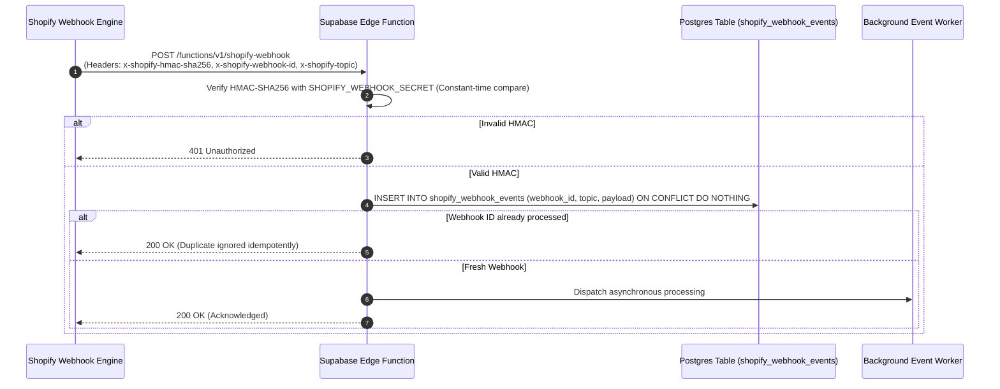

# Phase 3 — Shopify Data Model & Integration Architecture Specification

**Project:** IT HUB — E-Commerce & Service Platform Migration  
**Location:** Kerala, India  
**Target Date:** November 8, 2026  
**Implementation Branch:** `PH-3`  
**Integration Target:** `migration/shopify-integration`  

---

## 1. Executive Summary

Phase 3 establishes the authoritative data model, boundary contracts, and GraphQL/webhook schema mapping between IT HUB's frontend, Shopify Storefront/Admin systems, and Supabase's operational service engine.

In accordance with mandatory architectural rules:
- **Shopify is the sole source of truth** for retail products, retail variants, selling prices, compare-at MRP, stock quantities, cart lines, hosted checkout, retail orders, refunds, and fulfilment.
- **Supabase is preserved as the operational lab engine** for customer service tickets (`service_requests`), itemized diagnostic quotes (`quotations`, `quotation_items`), customer partial repair approvals, technician workbench logs, and second-hand trade-in evaluation pipelines (`trade_in_requests`).
- **Zero dual-write synchronization conflicts**: No retail catalog or order record is duplicated as an independent source of truth in Supabase. Supabase stores only operational metadata and references Shopify entity GIDs (`gid://shopify/...`).

---

## 2. Schema Ownership Matrix

| Domain Entity | Primary System of Record | Read Path | Write Path | Sync / Integration Strategy |
| :--- | :--- | :--- | :--- | :--- |
| **Retail Products & Variants** | **Shopify** | Shopify Storefront GraphQL API | Shopify Admin API / CSV Bulk Importer | Direct read model; cached in React client state |
| **Inventory Quantities** | **Shopify** | Storefront API (`quantityAvailable`, `availableForSale`) | Shopify Admin Inventory Levels API / POS | Authoritative stock checks at checkout boundary |
| **Pricing & Compare-at MRP** | **Shopify** | Storefront API (`price`, `compareAtPrice`) | Shopify Admin API | Selling price & MRP authored in Shopify. Client never submits price. |
| **Carts & Checkout** | **Shopify** | Storefront Cart GraphQL API | Storefront Cart Mutations (`cartCreate`, `cartLinesAdd`) | Native Shopify Hosted Checkout with Razorpay/UPI/Cards |
| **Retail Orders & Refunds** | **Shopify** | Shopify Admin & Customer Accounts | Shopify Checkout Engine & Admin Webhooks | Synced unidirectionally to Supabase via verified webhooks for customer timeline |
| **PC Builder Parts & Rules** | **Shopify + Hybrid Specs** | Storefront GraphQL + `pc_builder` Metafields | Shopify Admin Product Metafields | In-memory compatibility engine (`Builder.tsx`) evaluates AM5/LGA1700, DDR4/DDR5, TDP watts, and clearance |
| **Repair Tickets & Service** | **Supabase** | Supabase PostgREST with Customer RLS | Supabase PostgREST & Edge Functions | Standalone operational ticketing; final approved repair invoice can be converted to Shopify Draft Order |
| **Diagnostic Quotations & Approvals** | **Supabase** | Supabase PostgREST with Customer RLS | Supabase Authoritative RPC (`submit_repair_approval`) | Itemized parts & labor; customer partial approval engine with server-side recalculated totals |
| **Trade-In / Sell Submissions** | **Supabase** | Supabase PostgREST (`trade_in_requests`) | Supabase PostgREST / Admin Panel | Device evaluation, IMEI/serial intake, condition assessment; approved trade-ins can be published to Shopify via Admin API |

---

## 3. Product & Catalog Data Mapping

### 3.1 Field-by-Field Mapping from CSV Staging (1,359 SKUs) to Shopify

The staged inventory catalog contains **1,359 distinct product particulars** in `inventory_staging/normalized_inventory_import_template.csv`.

| CSV / Legacy Field | Shopify GraphQL Entity | Shopify Field / Destination | Type / Notes |
| :--- | :--- | :--- | :--- |
| `sku` | `ProductVariant` | `sku` | Unique identifier (e.g. `MTH-ASUS-B650M-A`) |
| `name` / `title` | `Product` | `title` | Product title (e.g. `ASUS PRIME B650M-A WIFI II`) |
| `brand` | `Product` | `vendor` | Manufacturer (e.g. `ASUS`, `Intel`, `AMD`) |
| `category` | `Product` | `productType` | Standardized category (e.g. `Motherboard`, `GPU`) |
| `subcategory` | `Product` | `tags` | Added as tag: `subcat:<subcategory>` |
| `selling_price` | `ProductVariant` | `price` | String decimal (e.g. `"14999.00"` INR) |
| `mrp` / `original` | `ProductVariant` | `compareAtPrice` | String decimal (e.g. `"17500.00"` INR) |
| `stock` / `quantity` | `InventoryLevel` | `available` | Tracked at IT HUB Store location |
| `description` | `Product` | `descriptionHtml` | Formatted product overview |
| `warranty` | `Product` | `metafields` (`custom.warranty_summary`) | e.g. `"3-Year Official Manufacturer Warranty"` |
| `condition` | `Product` | `metafields` (`custom.condition`) | `"New"`, `"Like New"`, `"Good"`, `"Fair"`, `"For Parts"` |
| `image_url` | `Product` / `ProductVariant` | `images` (`src`) | High-res CDN image |
| `weight` | `ProductVariant` | `weight` + `weightUnit` | In Kilograms / Grams for shipping |
| `hsn_code` | `ProductVariant` | `metafields` (`custom.hsn_code`) | Indian GST classification (e.g. `84713010`) |

---

## 4. Metafields & Metaobjects Architecture

To preserve IT HUB's custom PC Builder compatibility engine without maintaining a secondary product database, Shopify Metafields are configured under the dedicated namespace `pc_builder`.

### 4.1 PC Builder Metafield Schema (`namespace: pc_builder`)

| Key | Type | Description | Compatibility Use in `Builder.tsx` |
| :--- | :--- | :--- | :--- |
| `component_type` | `single_line_text_field` | `cpu`, `motherboard`, `ram`, `gpu`, `storage`, `psu`, `case`, `cooler` | Determines component slot |
| `socket` | `single_line_text_field` | `AM5`, `AM4`, `LGA1700`, `LGA1851`, `LGA1200` | CPU to Motherboard socket validation |
| `ram_generation` | `single_line_text_field` | `DDR5`, `DDR4` | RAM to Motherboard slot validation |
| `watts` | `number_integer` | Component TDP in Watts (e.g. `65`, `220`) | Total system wattage estimation |
| `capacity_watts` | `number_integer` | PSU capacity in Watts (e.g. `650`, `850`) | Verifies PSU exceeds calculated system TDP by >= 20% |
| `gpu_length_mm` | `number_integer` | Physical GPU length in mm (e.g. `304`) | Cabinet GPU clearance check |
| `cabinet_clearance_mm`| `number_integer` | Maximum GPU length supported by Case (e.g. `340`) | Case to GPU fit check |
| `storage_interface` | `single_line_text_field` | `M.2 NVMe PCIe 4.0`, `SATA III 2.5"` | Storage slot validation |
| `bios_update_required`| `boolean` | `true` / `false` | Alerts user if BIOS flash is required |
| `wifi` | `boolean` | `true` / `false` | Motherboard Wi-Fi capability badge |

### 4.2 Custom Storefront Metafield Schema (`namespace: custom`)

| Key | Type | Values / Examples | Purpose |
| :--- | :--- | :--- | :--- |
| `condition` | `single_line_text_field` | `New`, `Like New`, `Good`, `Fair`, `For Parts` | Second-hand & refurbished item badge |
| `warranty_summary` | `single_line_text_field` | `1-Year Official Warranty`, `90-Day IT HUB Testing Warranty` | Trust & warranty display |
| `hsn_code` | `single_line_text_field` | `8471`, `8473`, `8528` | Indian GST compliance & invoice generation |
| `serial_tracking_required` | `boolean` | `true` / `false` | Flags high-value components requiring IMEI/serial recording |

---

## 5. Webhook & Event Integration Architecture

### 5.1 Subscribed Shopify Webhook Topics

| Webhook Topic | Payload Entity | Action in IT HUB System | Idempotency Key |
| :--- | :--- | :--- | :--- |
| `orders/create` | Order | Insert order record into Supabase timeline; notify warehouse for dispatch | `x-shopify-webhook-id` / `order.id` |
| `orders/updated` | Order | Update shipping status, tracking number, delivery confirmation | `x-shopify-webhook-id` / `order.updated_at` |
| `orders/cancelled`| Order | Void order, mark customer timeline as cancelled, release any reserved resources | `x-shopify-webhook-id` / `order.id` |
| `refunds/create` | Refund | Record refund amount and reason in accounting logs | `x-shopify-webhook-id` / `refund.id` |
| `products/update`| Product | Invalidate storefront product cache in CDN / Redis | `x-shopify-webhook-id` / `product.updated_at` |
| `inventory_levels/update` | InventoryLevel | Update real-time out-of-stock badges on client storefront | `x-shopify-webhook-id` |

### 5.2 Security & Idempotency Pipeline

---

## 6. Indian Regulatory, Tax & Privacy Compliance

### 6.1 GST (Goods and Services Tax) Compliance (Kerala, India)
- **HSN Codes**: Captured in variant metafields (`custom.hsn_code`).
  - HSN 8471: Automatic data processing machines and units (Laptops, Desktops, Servers).
  - HSN 8473: Parts and accessories for computers (Motherboards, RAM, GPUs).
  - HSN 8528: Monitors and display equipment.
- **Intra-State vs Inter-State GST**:
  - Intra-State (Customer in Kerala): 9% CGST + 9% SGST (Total 18%).
  - Inter-State (Customer outside Kerala): 18% IGST.
  - Handled natively by Shopify Tax Engine with Kerala GSTIN registered.
- **MRP Transparency**: Under the Legal Metrology (Packaged Commodities) Rules, India, retail selling price must not exceed the Maximum Retail Price (MRP). The mapping layer strictly enforces `original` (compareAtPrice) >= `price`.

### 6.2 Digital Personal Data Protection (DPDP) Act 2023 Compliance
- Customer phone numbers, delivery addresses, and identity documents submitted during device trade-in are encrypted at rest using AES-GCM.
- Public Storefront API queries never return customer contact details or technician diagnostic notes.
- Data retention: Service requests older than 3 years with completed status are purged of customer contact particulars while preserving anonymized tax/accounting records.

---

## 7. Verification & Automated Test Coverage

The data model and mapping functions are covered by automated unit tests in `supabase/functions/tests/shopify-data-mapping.test.ts`:

- **MAP-1**: `parseShopifyGid` correctly extracts numeric IDs from Shopify GraphQL GIDs (`gid://shopify/Product/12345`).
- **MAP-2**: `toProductGid` and `toVariantGid` format GIDs idempotently without double-prefixing.
- **MAP-3**: `getMetafield` safely queries targeting namespaces and keys without null-pointer exceptions.
- **MAP-4**: `parseProductSpecs` parses colon/equal-separated tags and overlays custom metafields.
- **MAP-5**: `resolveProductCondition` respects metafield precedence over tags and normalizes hyphens/underscores to `"Like New"`, `"Good"`, `"Fair"`, `"For Parts"`, or `"New"`.
- **MAP-6**: `mapShopifyProductToCatalog` maps GraphQL nodes into frontend `Product` records, preserving MRP, condition, and deal tags.
- **MAP-7 & MAP-8**: `mapShopifyVariantToPcComponent` extracts hardware specs (`socket`, `ram_generation`, `watts`, `capacity_watts`, `gpu_length_mm`, `clearance`) for PC Builder compatibility calculation.

**Test Results:**
- `supabase/functions/tests/`: 192 tests passing across 12 test suites.
- TypeScript compilation (`tsc --noEmit`): 0 errors.
- Vite production build (`vite build`): Clean build (33.57s).
