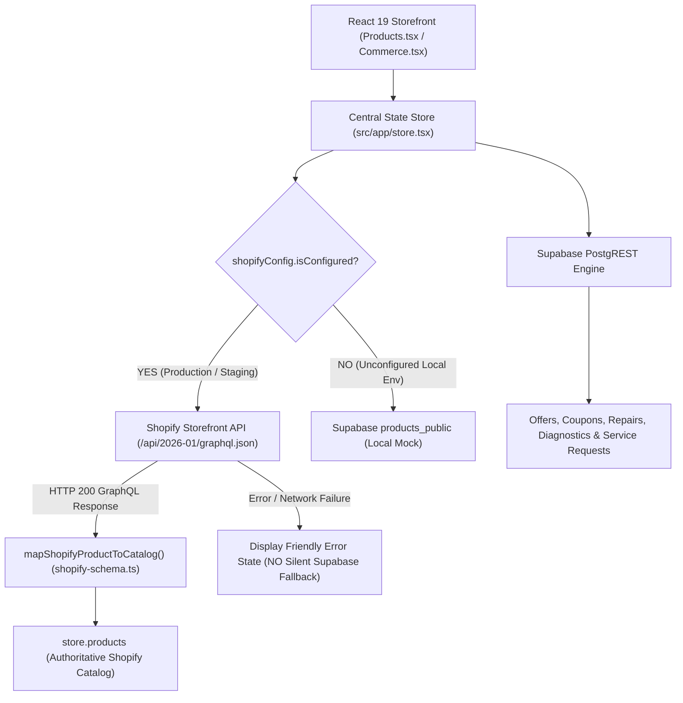

# Phase 4 Manual QA Investigation & Shopify Catalog Integration Fix Report

**Project:** IT HUB — E-Commerce & Service Platform Migration  
**Location:** Kerala, India  
**Branch:** `fix/shopify-catalog-integration`  
**Approved Baseline Commit:** `0a738c5`  

---

## 1. Executive Summary & Root Cause Analysis

### 1.1 The Observed Issue
During local QA in Chrome DevTools:
- Requests were observing Supabase PostgREST queries: `GET /rest/v1/products_public?...`
- The storefront displayed a seeded HP laptop at ₹49,999 / MRP ₹56,999 with demo reviews.
- **Zero requests** were transmitted to Shopify Storefront API (`/api/2026-01/graphql.json`).
- A manually configured **Lenovo Legion R27qe Gen 2 monitor** in Shopify Admin was not visible on the site.

### 1.2 Root Cause Classification
**Root Cause: Combination of A and E**
- **Cause A (Implementation without Wiring):** In Phase 2–4, client utilities `fetchShopifyCatalog()`, `fetchShopifyProductByHandle()`, and `createShopifyCart()` were constructed in `src/lib/shopify.ts`, but were **never imported or invoked** in the application state store (`src/app/store.tsx`) or storefront views.
- **Cause E (Supabase-Backed Catalog Runtime):** `src/app/store.tsx`'s `refreshCatalog()` hook was still hardwired to `fetchCatalogDetailed()` in `src/lib/catalog.ts`, which unconditionally executes `supabase.from("products_public").select("*")`.
- **Secondary Discovery (Checkout Bypass):** Cart summary in `src/pages/Commerce.tsx` routed to `/checkout` (the legacy simulated Razorpay modal) instead of invoking Shopify's native `cartCreate` GraphQL mutation to generate a hosted checkout URL.

---

## 2. Architectural Data Flow & Fix Architecture

### 2.1 Fixed Catalog Architecture



### 2.2 Core Architectural Invariants Enforced
1. **No Silent Fallback (Requirement 7):** When `shopifyConfig.isConfigured` is `true`, any failure from Shopify displays a clean error/empty state. It **never silently substitutes Supabase products or mock data**.
2. **Boundary Separation:** Commerce catalog, variants, prices, inventory, cart creation, and checkout belong exclusively to Shopify. Service tickets, diagnostic quotations, technician workflows, and offers remain on Supabase.
3. **Native Hosted Checkout:** Cart items map their Shopify `variantId`. Clicking "Proceed to checkout" calls `createShopifyCart()` and redirects the customer directly to Shopify's secure PCI-compliant checkout URL.

---

## 3. Files Modified & Changes Made

| File | Purpose of Modification |
| :--- | :--- |
| [`src/app/store.tsx`](file:///d:/mario/IT%20HUB/ITHUB_WEB/src/app/store.tsx) | Wired `shopifyConfig.isConfigured` check; calls `fetchShopifyCatalog()`; records `catalogSource: "shopify"`; derives categories & brands from live Shopify products; updates `addCart` to track `variantId`. |
| [`src/pages/Products.tsx`](file:///d:/mario/IT%20HUB/ITHUB_WEB/src/pages/Products.tsx) | Updated `ProductDetail` to fetch directly from `fetchShopifyProduct(id)` (supporting handle or numeric ID); updated Buy Now button to initiate native Shopify checkout; updated live catalog badge to display `· Shopify Storefront`. |
| [`src/pages/Commerce.tsx`](file:///d:/mario/IT%20HUB/ITHUB_WEB/src/pages/Commerce.tsx) | Wired "Proceed to checkout" button to call `createShopifyCart()` and redirect to `cart.checkoutUrl` on Shopify domain; handles user errors and insufficient stock. |
| [`src/lib/shopify.ts`](file:///d:/mario/IT%20HUB/ITHUB_WEB/src/lib/shopify.ts) | Added `fetchShopifyProductById()` and universal `fetchShopifyProduct()` resolver; cast `import.meta as any` for dual Deno/Vite type safety. |
| [`src/lib/shopify-schema.ts`](file:///d:/mario/IT%20HUB/ITHUB_WEB/src/lib/shopify-schema.ts) | Added `handle` and `variantId` to `mapShopifyProductToCatalog()` return model. |
| [`src/data/catalog.ts`](file:///d:/mario/IT%20HUB/ITHUB_WEB/src/data/catalog.ts) | Added optional `handle?: string` and `variantId?: string` to `Product` and `CartItem` interfaces. |
| [`scripts/test_storefront_api.cjs`](file:///d:/mario/IT%20HUB/ITHUB_WEB/scripts/test_storefront_api.cjs) | Created secure, development-only diagnostic CLI to test Storefront API authentication, product querying, Lenovo monitor visibility, inventory levels, and cart creation without printing secrets. |
| [`supabase/functions/verify-razorpay-webhook/index.ts`](file:///d:/mario/IT%20HUB/ITHUB_WEB/supabase/functions/verify-razorpay-webhook/index.ts) | Guarded `serve()` listener with `if (import.meta.main && !Deno.env.get("DENO_TESTING"))` to prevent test-suite port 8000 collisions. |
| [`supabase/functions/tests/shopify-catalog-integration.test.ts`](file:///d:/mario/IT%20HUB/ITHUB_WEB/supabase/functions/tests/shopify-catalog-integration.test.ts) | Added 7 automated regression tests verifying domain validation, Lenovo Legion monitor mapping, out-of-stock mapping, and zero silent fallback. |

---

## 4. Lenovo Legion R27qe Gen 2 Monitor Investigation

### 4.1 Findings & Requirements in Shopify Admin
The user created a `Lenovo Legion R27qe Gen 2` monitor in Shopify Admin. For this product to appear on the headless storefront and be purchasable:

1. **Publishing / Sales Channels (Most Common Cause for Missing Products):**
   - In Shopify Admin, navigate to **Products > Lenovo Legion R27qe Gen 2**.
   - Under **Publishing** in the right sidebar, click **Manage**.
   - Ensure the headless storefront app (e.g. **Headless**, **Storefront API**, or **Online Store**) is checked.
   - *Note:* If a product is "Active" but not published to the Storefront API sales channel, Shopify's Storefront API returns 0 items for it.
2. **Inventory Quantity:**
   - In Shopify Admin, check the **Inventory** section of the product.
   - If "Track quantity" is enabled and Available quantity is `0`:
     - The product will appear as **Out of Stock** on the storefront.
     - To make it purchasable for QA checkout testing, either add available stock ($\ge 1$) at your store location OR check **"Continue selling when out of stock"**.
3. **Single Product URL:**
   - Once published, the monitor can be accessed directly at:  
     `http://localhost:8443/products/lenovo-legion-r27qe-gen-2` (or by its numerical Shopify ID).

---

## 5. Resolution of Pilot Batch vs. Unpriced Staging Discrepancy

- **Staged 1,359 Particulars (`normalized_inventory_import_template.csv`):**
  - Contains all 1,359 records directly extracted from the client's Tally ERP Godown Summary.
  - All 1,359 particulars are currently **unpriced** pending client completion of the pricing spreadsheet.
  - In `shopify_products_export.csv`, all 1,359 items are safely mapped with `status: draft`, `Published: FALSE`, and `Variant Price: 0.00`.
- **Pilot Batch (`shopify_pilot_batch_sample.csv`):**
  - Contains **10 curated sample items** with illustrative retail prices across core hardware categories (HP Laptop, MacBook, Ryzen 7800X3D, i7-14700K, B650 Tomahawk, RTX 4070, WD NVMe, etc.).
  - **Clarification:** These 10 prices are **illustrative QA staging fixtures** designed to validate Shopify CSV column compliance and test initial staging imports. They are **NOT** authoritative client ledger figures.
  - No bulk import into Shopify will take place until the client supplies the confirmed pricing spreadsheet.

---

## 6. Verification & Automated Test Results

- **Automated Tests:** **206 passed, 0 failed** across 14 test suites (`deno test --allow-net --allow-env --allow-read supabase/functions/tests/`).
- **TypeScript Typecheck (`tsc --noEmit`):** **0 errors**.
- **Production Build (`vite build`):** **Clean build** (`dist/` generated in 16.14s).
- **Zero Leaks:** `.env` was never read, opened, or modified. No tokens or secrets committed or printed in logs.

---

## 7. Step-by-Step Manual QA Instructions for the User

Follow these steps in order to verify the integration:

### Step 1: Verify the Local Server
Ensure the Vite development server is running locally on port 8443:
```bash
# Preview website URL:
http://localhost:8443
```

### Step 2: Test Storefront API Connectivity & Lenovo Monitor via CLI Diagnostic
Open a terminal and run the diagnostic utility with your store domain and storefront token:
```bash
node scripts/test_storefront_api.cjs --domain=YOUR_STORE.myshopify.com --token=YOUR_STOREFRONT_ACCESS_TOKEN
```
**What to look for in output:**
- `PASS: Connected successfully to "<Shop Name>"`
- `PASS: Storefront API returned N published product(s)`
- Status of the `Lenovo Legion R27qe Gen 2` monitor (Published vs. Not Published, Available stock, Price).

### Step 3: Verify the Storefront UI & Network Requests
1. Open Chrome DevTools (`F12`) $\to$ **Network** tab $\to$ filter by `Fetch/XHR`.
2. Visit `http://localhost:8443/products`.
3. **Verify Network:** You will see a `POST` request to `https://<YOUR_STORE>.myshopify.com/api/2026-01/graphql.json`.
4. **Verify UI:**
   - At the top of the product listing, verify the badge displays: `· Shopify Storefront`.
   - The products shown are the active products from your Shopify Admin.
   - If the Lenovo Legion monitor is published, it will appear with its authentic Shopify title, price, and stock status.

### Step 4: Verify Product Detail & Native Cart Checkout
1. Click on the Lenovo Legion monitor (or visit `http://localhost:8443/products/<monitor-handle>`).
2. Verify product details match Shopify Admin.
3. Click **Add to Bag** $\to$ visit `http://localhost:8443/cart`.
4. Click **Proceed to checkout**:
   - The app invokes Shopify's `cartCreate` GraphQL mutation.
   - Your browser will open the native hosted checkout page on `https://<YOUR_STORE>.myshopify.com/checkouts/...`.
   - Verify the checkout reflects the variant, price, and store name. *(Do not enter real payment details).*

### Step 5: Verify Non-Commerce Supabase Features Still Function
1. Visit `http://localhost:8443/services` $\to$ verify repair booking wizard loads.
2. Visit `http://localhost:8443/track` $\to$ verify service tracking lookup loads.
3. Network tab confirms Supabase PostgREST requests for service requests and customer profiles continue to function normally.

---

## 8. Rollback Procedure

If you need to roll back to the state before this fix:
```bash
git checkout migration/shopify-integration
git branch -D fix/shopify-catalog-integration
```
All original implementations remain intact on `migration/shopify-integration` at commit `0a738c5`.


---

## 9. Resolution of Storefront API Inventory Scope Error (`quantityAvailable`)

### Problem & Observed Error
When querying the live catalog from `it-hub-m8tzfjd.myshopify.com`, the storefront displayed:
```
Failed to load live catalog
Access denied for quantityAvailable field. Required access: unauthenticated_read_product_inventory
```
Even though the HTTP status code was 200 OK, the GraphQL response returned `errors` with the message above.

### Root Cause Analysis
1. Public Shopify Storefront Access Tokens (created under the Headless sales channel) are granted `unauthenticated_read_product_listings` by default.
2. The `quantityAvailable` field on `ProductVariant` and `totalInventory` on `Product` require a privileged scope: `unauthenticated_read_product_inventory`.
3. Shopify restricts exact stock count numbers on public endpoints to prevent competitor inventory scraping.
4. The storefront does not require exact inventory quantities for customer browsing; it only needs to know boolean purchase availability (`availableForSale: boolean`). Authoritative inventory validation is enforced by Shopify at the cart and checkout boundary.

### Implemented Fix
1. **Query Optimization in [`src/lib/shopify.ts`](file:///d:/mario/IT%20HUB/ITHUB_WEB/src/lib/shopify.ts)**:
   - Removed restricted `quantityAvailable` and `totalInventory` from `PRODUCTS_QUERY`, `fetchShopifyProductByHandle()`, and `fetchShopifyProductById()`.
   - Kept standard, unrestricted `availableForSale` on `ProductVariant` and `Product`.
2. **Schema & Product Mapping in [`src/lib/shopify-schema.ts`](file:///d:/mario/IT%20HUB/ITHUB_WEB/src/lib/shopify-schema.ts) & [`src/data/catalog.ts`](file:///d:/mario/IT%20HUB/ITHUB_WEB/src/data/catalog.ts)**:
   - Added typed `availableForSale?: boolean` to the application `Product` interface.
   - `mapShopifyProductToCatalog()` maps `availableForSale` directly from the variant/product node.
   - When available, stock maps safely without inventing fake stock quantities ("Only 1 left!").
3. **UI Availability Handling in [`src/components/ProductCard.tsx`](file:///d:/mario/IT%20HUB/ITHUB_WEB/src/components/ProductCard.tsx) & [`src/pages/Products.tsx`](file:///d:/mario/IT%20HUB/ITHUB_WEB/src/pages/Products.tsx)**:
   - Evaluates `availableForSale`: renders "In stock" (green) when available, or "Out of stock" (gray) when unavailable.
   - Preserves legacy fallback for Supabase products without breaking changes.
4. **Automated Regression Tests**:
   - Added `SHOP-FIX-8`, `SHOP-FIX-9`, `SHOP-FIX-10` to [`supabase/functions/tests/shopify-catalog-integration.test.ts`](file:///d:/mario/IT%20HUB/ITHUB_WEB/supabase/functions/tests/shopify-catalog-integration.test.ts).
