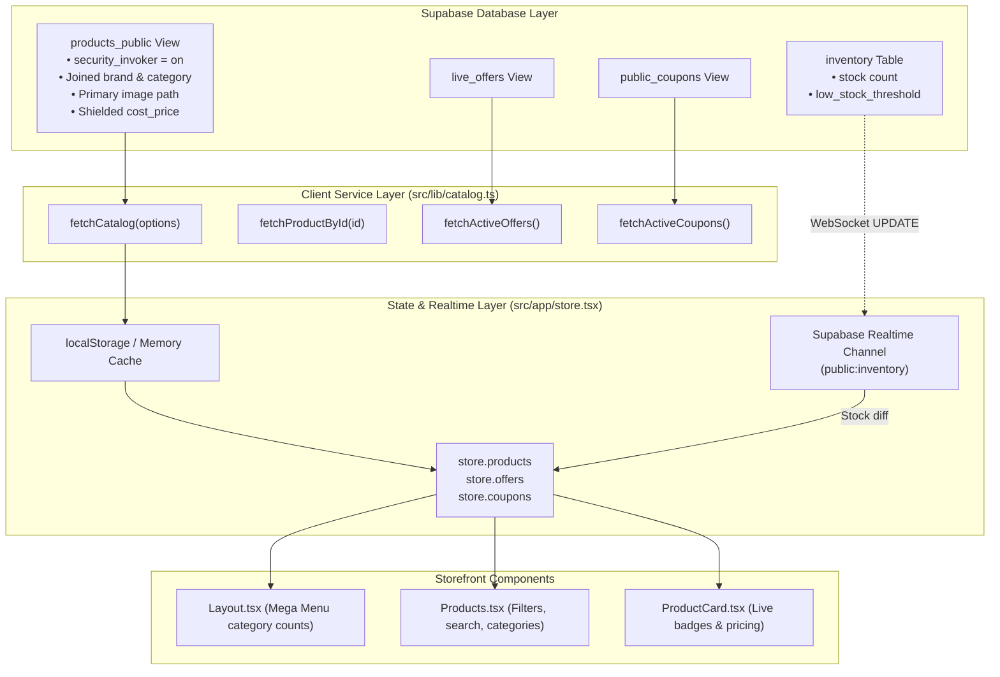

# Phase 3: Live Catalog & Realtime Inventory Synchronization

**Status**: Ready for Implementation  
**Target Milestone**: Seamless integration between Supabase PostgreSQL catalog tables and the storefront UI with WebSocket inventory synchronization.

---

## 1. Objectives & Key Results (OKRs)

- **Objective 1**: Replace static `catalog.ts` imports with live queries to Supabase `products_public` view.
- **Objective 2**: Support real-time stock deductions and badge updates using Supabase Realtime WebSockets on `inventory`.
- **Objective 3**: Implement an instant stale-while-revalidate cache ensuring `<10ms` initial page loads with silent background revalidation.
- **Objective 4**: Enable real-time promotional banner fetching from `live_offers` and coupons from `public_coupons`.

---

## 2. Technical Architecture



---

## 3. Detailed Implementation Steps

### Step 3.1: Enrich `products_public` View in Schema
In [`supabase/schema.sql`](file:///d:/mario/IT%20HUB/ITHUB_WEB/supabase/schema.sql), enrich the `products_public` view to return brand and category names directly, along with the primary image:

```sql
create or replace view products_public with (security_invoker = on, security_barrier = true) as
  select
    p.id,
    p.sku,
    p.name,
    b.name as brand,
    c.name as category,
    p.subcategory,
    p.description,
    p.mrp,
    p.price,
    p.sale_price,
    coalesce(p.sale_price, p.price) as effective_price,
    p.warranty,
    p.weight,
    p.specs,
    p.second_hand,
    p.condition,
    p.status,
    p.created_at,
    coalesce(i.stock, 0) as stock,
    (
      select storage_path 
      from product_images 
      where product_id = p.id 
      order by position asc limit 1
    ) as primary_image
  from products p
  left join brands b on b.id = p.brand_id
  left join categories c on c.id = p.category_id
  left join inventory i on i.product_id = p.id
  where p.status = 'Active';

alter view products_public set (security_invoker = on, security_barrier = true);
```

---

### Step 3.2: Create Type-Safe Catalog Client Service ([`src/lib/catalog.ts`](file:///d:/mario/IT%20HUB/ITHUB_WEB/src/lib/catalog.ts))
Expose clean, reusable methods that normalize database rows into the React application's `Product` model:

- `fetchCatalog(options)`:
  - Supports filters: `category`, `brand`, `second_hand`, `search`, `price_min`, `price_max`, `sort`.
  - Maps `effective_price` $\rightarrow$ `price`, `mrp` $\rightarrow$ `original`.
- `fetchProductById(idOrSku)`: Fetches product detail with specifications and gallery URLs.
- `fetchActiveOffers()`: Fetches active promotions from `live_offers`.
- `fetchActiveCoupons()`: Fetches eligible discount codes from `public_coupons`.

---

### Step 3.3: Store Integration & Stale-While-Revalidate Hydration
In [`src/app/store.tsx`](file:///d:/mario/IT%20HUB/ITHUB_WEB/src/app/store.tsx):
1. **Immediate Rendering**: Initialize state using cached/initial catalog data so the user never sees an empty screen or loading spinner.
2. **Background Sync**: On mount, trigger `fetchCatalog()`. When data returns from Supabase, update `state.products` seamlessly.
3. **Graceful Fallback**: If network is disconnected, retain cached catalog without throwing unhandled exceptions.

---

### Step 3.4: Supabase Realtime Inventory Subscription
In [`src/app/store.tsx`](file:///d:/mario/IT%20HUB/ITHUB_WEB/src/app/store.tsx):
- Initialize Realtime WebSocket channel:
  ```typescript
  const channel = supabase
    .channel('inventory-changes')
    .on(
      'postgres_changes',
      { event: 'UPDATE', schema: 'public', table: 'inventory' },
      (payload) => {
        const { product_id, stock } = payload.new
        set((state) => ({
          products: state.products.map((p) =>
            p.id === product_id ? { ...p, stock } : p
          ),
        }))
      }
    )
    .subscribe()
  ```
- In [`src/components/ProductCard.tsx`](file:///d:/mario/IT%20HUB/ITHUB_WEB/src/components/ProductCard.tsx):
  - Badge logic:
    - `stock > 5`: "In Stock"
    - `stock > 0 && stock <= 5`: "Only {stock} left!"
    - `stock === 0`: "Out of Stock" (disables Add to Cart)

---

### Step 3.5: Storefront UI Verification
- Verify search query matching and category selection in [`src/pages/Products.tsx`](file:///d:/mario/IT%20HUB/ITHUB_WEB/src/pages/Products.tsx).
- Verify Second-Hand toggle cleanly separates fresh products from pre-owned devices.
- Verify mega-menu in [`src/components/Layout.tsx`](file:///d:/mario/IT%20HUB/ITHUB_WEB/src/components/Layout.tsx) computes live counts directly from database categories.

---

## 4. Acceptance Criteria & Test Plan

| Test Case | Expected Result |
| :--- | :--- |
| **Catalog Load** | Products load from `products_public` and populate storefront |
| **Offline Mode** | Disconnecting internet maintains catalog from cache |
| **Realtime Stock Update** | Updating stock in Supabase instantly updates badge on UI |
| **Out of Stock** | Items with 0 stock disable cart button and show red badge |
| **Search & Filters** | Category, brand, and text search filter products accurately |

