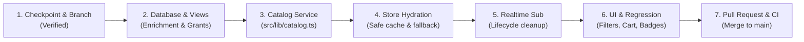

# Phase 3: Live Catalog & Realtime Inventory Synchronization

**Status**: Ready for Implementation (Pre-Implementation Checkpoint Passed)  
**Branch**: `feature/phase-3-catalog-inventory`  
**Target Milestone**: Transition the storefront from static `catalog.ts` imports to a live, Supabase-backed catalog with WebSocket inventory updates, database-driven offers, and hardened checkout safeguards.

---

## 1. Objectives & Measurable Performance Targets

- **Objective 1 (Live Catalog)**: Query active catalog records from the hardened `products_public` view, supporting category, brand, search, price, and second-hand filters.
- **Objective 2 (Realtime Display Updates)**: Subscribe to `inventory` table updates over Supabase Realtime WebSockets to dynamically refresh availability badges ("In Stock", "Only X left", "Out of Stock") without page reloads.
- **Objective 3 (Promotions & Coupons)**: Fetch active promotions from `live_offers` and display eligible discount codes from `public_coupons`.
- **Objective 4 (Performance Target)**: Immediate client-side render (<50ms) using stale-while-revalidate local cache, with background network synchronization completing in <500ms (p95 on 4G/broadband).
- **Objective 5 (Concurrency & Overselling Protection)**: Treat Realtime as a display indicator only. All stock reservations and pricing calculations are enforced atomically on the trusted PostgreSQL backend via `create_order()`.

---

## 2. Technical Architecture

```mermaid
flowchart TD
    subgraph Postgres["Supabase PostgreSQL 15 Layer"]
        ViewProducts["products_public View\n• security_invoker = on\n• Joined brand & category\n• Primary image path\n• Shielded cost_price"]
        ViewOffers["live_offers View"]
        ViewCoupons["public_coupons View"]
        TableInv["inventory Table\n• publication: supabase_realtime\n• Row-level locking: FOR UPDATE"]
        RPCOrder["create_order() RPC\n• Authoritative stock check\n• Atomic reservation"]
    end

    subgraph ServiceLayer["Client Service Layer (src/lib/catalog.ts)"]
        ServiceFetch["fetchCatalog(options)"]
        ServiceDetail["fetchProductById(id)"]
        ServiceOffers["fetchActiveOffers()"]
        ServiceCoupons["fetchActiveCoupons()"]
    end

    subgraph StoreLayer["State & Lifecycle Layer (src/app/store.tsx)"]
        CacheStorage["Stale-While-Revalidate Cache\n(Non-Authoritative)"]
        RealtimeChannel["Supabase Realtime Channel\n(Cleaned up on unmount)"]
        StoreState["store.products\nstore.offers\nstore.coupons"]
    end

    subgraph Views["Storefront Components"]
        MegaMenu["Layout.tsx (Category counts)"]
        ProductsPage["Products.tsx (Filters, search, categories)"]
        Cards["ProductCard.tsx (Live stock badge)"]
        Checkout["Commerce.tsx (Checkout Action)"]
    end

    ViewProducts --> ServiceFetch
    ViewOffers --> ServiceOffers
    ViewCoupons --> ServiceCoupons
    TableInv -.->|WebSocket UPDATE (Display Only)| RealtimeChannel

    ServiceFetch --> CacheStorage
    CacheStorage --> StoreState
    RealtimeChannel -->|Stock diff badge update| StoreState

    StoreState --> MegaMenu
    StoreState --> ProductsPage
    StoreState --> Cards

    Checkout -->|Atomic Reservation| RPCOrder
    RPCOrder --> TableInv
```

---

## 3. Critical Security & Implementation Adjustments

### 3.1. Database Security & Permissions Validation

- **View Security**: `products_public`, `live_offers`, and `public_coupons` are defined with `WITH (security_invoker = on, security_barrier = true)`.
- **Caller Permission Verification**:
  Because `security_invoker = on` executes under the calling role's permissions, verify that both `anon` and `authenticated` roles can select required columns from underlying tables:
  ```sql
  -- Products (cost_price strictly excluded)
  GRANT SELECT (id, sku, name, brand_id, category_id, subcategory, description,
                mrp, price, sale_price, warranty, weight, specs, second_hand,
                condition, status, created_at, updated_at)
  ON public.products TO anon, authenticated;

  -- Inventory (read stock count for catalog display)
  GRANT SELECT (product_id, stock, low_stock_threshold)
  ON public.inventory TO anon, authenticated;

  -- Brands & Categories
  GRANT SELECT (id, name, parent_id) ON public.categories TO anon, authenticated;
  GRANT SELECT (id, name) ON public.brands TO anon, authenticated;

  -- Offers & Coupons
  GRANT SELECT ON public.offers TO anon, authenticated;
  GRANT SELECT ON public.coupons TO anon, authenticated;
  ```

### 3.2. Realtime Publication Configuration

- Realtime requires the `inventory` table to be added to the Supabase replication publication:
  ```sql
  alter publication supabase_realtime add table public.inventory;
  ```
- Ensure `REPLICA IDENTITY` is set to `DEFAULT` or `FULL` on `inventory` so update payloads include the `product_id` primary key.

### 3.3. Stock Accuracy & Overselling Prevention

- **Display vs Authoritative Action**:
  - The frontend stock badge is an **advisory display** to improve UX.
  - Two customers may open the product page simultaneously with 1 unit remaining.
  - When either clicks "Place Order", the authoritative reservation occurs inside `create_order(...)` using `SELECT ... FOR UPDATE` row-level locks. If stock is exhausted, the procedure throws an exception and halts payment initiation.

### 3.4. Cache Strategy & Invalidation

- **Stale-While-Revalidate**:
  - Store renders immediately using local storage cache for instant navigation.
  - Asynchronously revalidates against `products_public` in the background.
- **Non-Authoritative Cache**:
  - Prices or stock values in `localStorage` are **never trusted** by the checkout flow.
  - Checkout always submits `{ product_id, quantity }` to `create_order`, which re-calculates pricing and discounts from authoritative PostgreSQL tables.

### 3.5. React Lifecycle & Realtime Cleanup

- When the store mounts, create the Realtime channel.
- **Cleanup Pattern**: Always unsubscribe and remove the channel when unmounting or re-establishing connections to prevent memory leaks or duplicate WebSocket listeners:
  ```typescript
  useEffect(() => {
    const channel = supabase
      .channel("public:inventory")
      .on(
        "postgres_changes",
        { event: "UPDATE", schema: "public", table: "inventory" },
        (payload) => handleStockUpdate(payload.new),
      )
      .subscribe();

    return () => {
      supabase.removeChannel(channel);
    };
  }, []);
  ```

### 3.6. Coupon Validation Rule Enforcement

- `public_coupons` view displays available coupon codes and minimum order values publicly.
- All coupon redemption restrictions (expiry dates, minimum order values, and the one-use-per-customer rule in `coupon_usages`) are validated server-side by `validate_coupon()` and `create_order()`.

---

## 4. Step-by-Step Implementation Sequence



### Step 1: Pre-Implementation Checkpoint (COMPLETED)

- Verified clean git working tree on `feature/phase-3-catalog-inventory`.
- Confirmed zero tracked `.env` or sensitive secret files.
- Added GitHub Actions CI check (`.github/workflows/ci.yml`).
- Added `lint`, `typecheck`, and `test` scripts to `package.json`.

### Step 2: Database View Enrichment & Realtime Publication

- Enrich `products_public` in `supabase/schema.sql` to join `brand` and `category` text directly, and extract the primary image path.
- Add `public.inventory` to `supabase_realtime` publication.
- Seed fresh products into `supabase/seed.sql`.

### Step 3: Type-Safe Catalog Service ([`src/lib/catalog.ts`](file:///d:/mario/IT%20HUB/ITHUB_WEB/src/lib/catalog.ts))

- Implement:
  - `fetchCatalog(options)`: Filtered catalog query.
  - `fetchProductById(idOrSku)`: Full product specification and image gallery.
  - `fetchActiveOffers()`: Active promotional banners from `live_offers`.
  - `fetchActiveCoupons()`: Valid coupon codes from `public_coupons`.

### Step 4: Global Store Integration ([`src/app/store.tsx`](file:///d:/mario/IT%20HUB/ITHUB_WEB/src/app/store.tsx))

- Implement stale-while-revalidate catalog loading with graceful offline fallback.
- Never block initial render on network latency.

### Step 5: Realtime Inventory Subscription

- Wire WebSocket listener on `inventory` table with proper `useEffect` cleanup.
- Update `ProductCard.tsx` availability badges ("In Stock", "Only X left", "Out of Stock").

### Step 6: Storefront UI Verification

- Validate search, filters (category, brand, price, second-hand), mega-menu category counts, and cart add/remove actions.

### Step 7: Pull Request & CI Verification

- Push branch, run GitHub Actions CI check, and merge into `main` after verification.

---

## 5. Acceptance Criteria & Test Plan

| Test Case                | Method                            | Expected Result                                                                |
| :----------------------- | :-------------------------------- | :----------------------------------------------------------------------------- |
| **View Permissions**     | Query `products_public` as `anon` | Returns product rows with brand/category names; `cost_price` cannot be queried |
| **Realtime Publication** | Update inventory in SQL Editor    | WebSocket message received in client, stock badge updates live                 |
| **Offline Resilience**   | Disconnect network in DevTools    | Storefront loads instantly from local cache without crash                      |
| **Overselling Guard**    | Two sessions buy last item        | First succeeds; second receives atomic out-of-stock error                      |
| **Channel Cleanup**      | Unmount/navigate away from store  | Channel is unsubscribed without leaking connections                            |
| **CI Validation**        | Run GitHub Actions workflow       | Lint, typecheck, tests, and build all pass with code 0                         |
