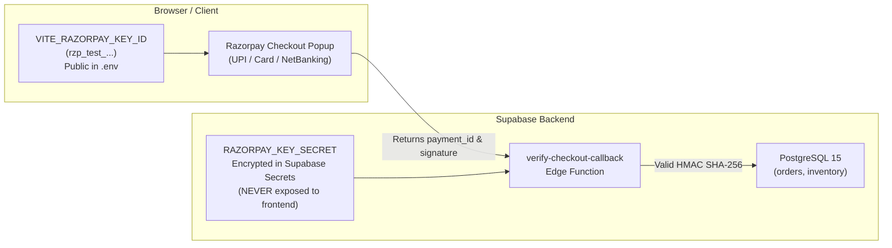

# Phase 4: End-to-End Checkout & Razorpay Settlement

**Status**: Planned  
**Target Milestone**: Real Indian payment processing with Razorpay, cryptographic HMAC SHA-256 signature verification, and atomic inventory reservation.

---

## 1. Objectives & Key Results (OKRs)

- **Objective 1**: Wire [`src/pages/Commerce.tsx`](file:///d:/mario/IT%20HUB/ITHUB_WEB/src/pages/Commerce.tsx) cart checkout to call `create_order` RPC, reserving inventory for 30 minutes.
- **Objective 2**: Launch the official Razorpay Checkout modal styled in IT HUB brand blue (`#0c2f8a`) supporting UPI, Debit/Credit Cards, and NetBanking.
- **Objective 3**: Verify payment signatures securely on the server via `verify-checkout-callback` Edge Function using `RAZORPAY_KEY_SECRET`.
- **Objective 4**: Enable live order tracking at `/track-order/:id`.

---

## 2. Key Architecture & Secrets Separation



---

## 3. Detailed Implementation Steps

### Step 4.1: Environment & Secrets Setup
- **Client**: Set `VITE_RAZORPAY_KEY_ID` in [`.env`](file:///d:/mario/IT%20HUB/ITHUB_WEB/.env).
- **Backend**: Set secrets in Supabase CLI / Dashboard:
  ```bash
  supabase secrets set RAZORPAY_KEY_ID=rzp_test_...
  supabase secrets set RAZORPAY_KEY_SECRET=your_secret_here
  ```

---

### Step 4.2: Edge Function Deployment (`verify-checkout-callback`)
The Edge Function verifies:
1. Customer JWT session validity via `auth.uid()`.
2. HMAC-SHA256 signature:
   $$\text{generated\_signature} = \text{HMAC\_SHA256}(\text{order\_id} + "|" + \text{payment\_id},\; \text{secret})$$
3. On signature match, executes database transaction to update `orders` status to `'Confirmed'` and `payment_status` to `'Paid'`.

---

### Step 4.3: Storefront Checkout Flow
1. Customer clicks "Place Order" in [`src/pages/Commerce.tsx`](file:///d:/mario/IT%20HUB/ITHUB_WEB/src/pages/Commerce.tsx).
2. App invokes `createSupabaseOrder()` in [`src/lib/payments.ts`](file:///d:/mario/IT%20HUB/ITHUB_WEB/src/lib/payments.ts).
3. PostgREST runs `create_order` RPC:
   - Validates user session.
   - Checks inventory stock.
   - Inserts order with 30-minute expiry window.
   - Returns order ID.
4. App invokes `launchRazorpayModal()` to open payment UI.
5. On success callback, `verifyCheckoutCallback()` submits credentials to Edge Function.
6. On success, customer is redirected to `/track-order/:id`.

---

## 4. Test Scenarios (Test Mode)

| Method | Test Credentials | Expected Outcome |
| :--- | :--- | :--- |
| **UPI** | `success@razorpay` | Instant approval, order confirmed |
| **UPI** | `failure@razorpay` | Declined, customer prompted to retry |
| **Card** | `4111 1111 1111 1111`, OTP `123456` | Card charged successfully |
| **NetBanking** | Select any test bank (SBI/HDFC) | Simulated bank approval flow |

