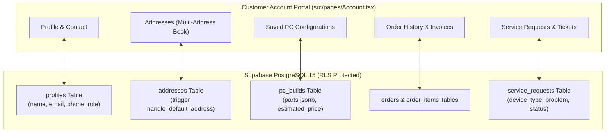

# Phase 5: Customer Account & Profile Management

**Status**: Planned  
**Target Milestone**: Comprehensive customer self-service portal, multi-address management, cloud PC build storage, and service booking tracking.

---

## 1. Objectives & Scope

- **Objective 1**: Enable customers to manage multiple shipping and billing addresses (`addresses` table) with automatic default selection enforcement.
- **Objective 2**: Synchronize custom PC builds designed in [`src/pages/Builder.tsx`](file:///d:/mario/IT%20HUB/ITHUB_WEB/src/pages/Builder.tsx) to `pc_builds` in Supabase under authenticated customer accounts.
- **Objective 3**: Wire the IT services booking wizard in [`src/pages/Services.tsx`](file:///d:/mario/IT%20HUB/ITHUB_WEB/src/pages/Services.tsx) to insert into `service_requests` and enable real-time tracking at `/track-service/:id`.
- **Objective 4**: Allow customers to view order history, download invoices, and access one-click brand warranty assistance.

---

## 2. Technical Architecture

---

## 3. Implementation Tasks

### Task 5.1: Customer Address Book Management
- Wire `addresses` table in [`src/pages/Account.tsx`](file:///d:/mario/IT%20HUB/ITHUB_WEB/src/pages/Account.tsx).
- Support Adding, Editing, Deleting, and Setting a Default Address.
- The PostgreSQL trigger `handle_default_address` ensures that setting one address as default automatically unsets others for that customer.

### Task 5.2: Cloud-Synced Custom PC Builds
- When customers customize a PC in [`src/pages/Builder.tsx`](file:///d:/mario/IT%20HUB/ITHUB_WEB/src/pages/Builder.tsx) and click "Save Build", prompt for login (if unauthenticated) and persist to `pc_builds`.
- Stored fields: `name`, `purpose`, `parts` (JSONB array), `total_price`, `assembly_included`.
- Actions in Account: Rename build, side-by-side comparison, share build link, and "Add Entire Build to Cart".

### Task 5.3: Service Booking & Ticket Tracking
- Connect the 6-step booking wizard in [`src/pages/Services.tsx`](file:///d:/mario/IT%20HUB/ITHUB_WEB/src/pages/Services.tsx):
  - Step 1: Device Category (Laptop, Mobile, PC, Printer)
  - Step 2: Problem Description
  - Step 3: Service Method (Store drop-off vs On-site pickup)
  - Step 4: Customer Details & Address
  - Step 5: Preferred Date & Time Slot
  - Step 6: Confirmation
- Writes to `service_requests`. Generates tracking reference for `/track-service/:id`.

---

## 4. Verification Checkpoints

| Feature | Verification Method |
| :--- | :--- |
| **Address Mutation** | Insert/Edit address $\rightarrow$ verify only 1 default exists |
| **Build Persistence** | Save PC build $\rightarrow$ log out & log in on another browser $\rightarrow$ build loads |
| **Service Request** | Book service $\rightarrow$ verify record in `service_requests` with status `'Pending'` |

