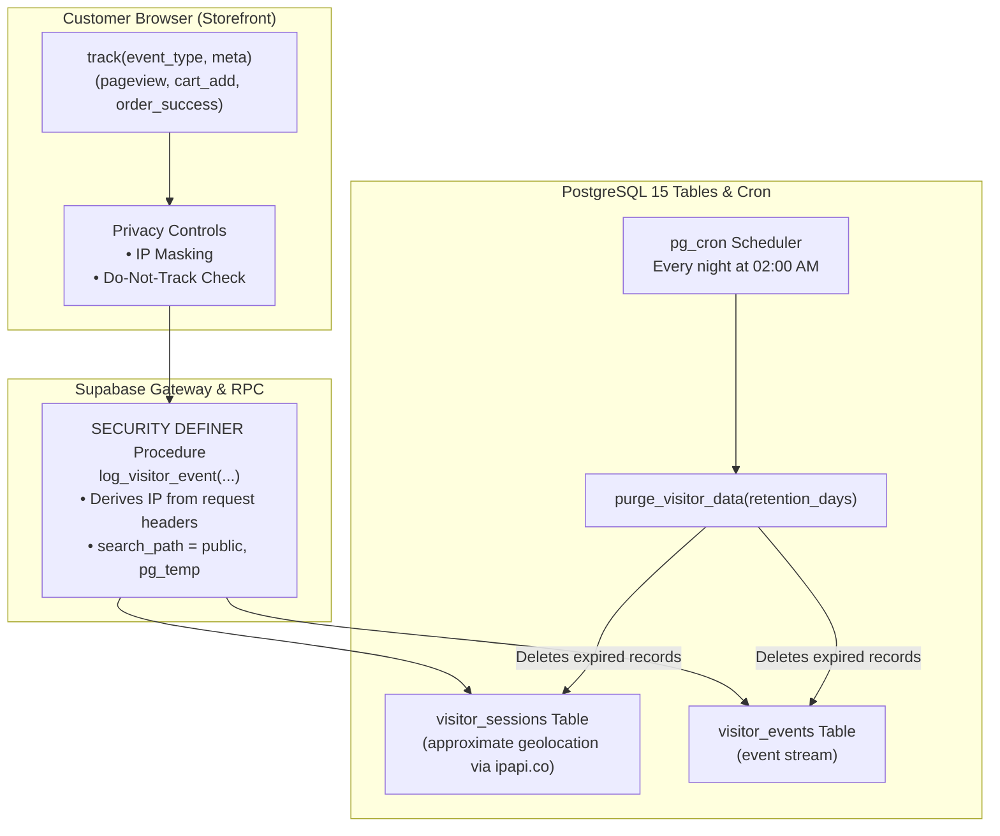

# Phase 6: Live Visitor Analytics Ingestion & Privacy Pruning

**Status**: Planned  
**Target Milestone**: Privacy-compliant storefront analytics ingestion into Supabase with automated `pg_cron` data retention pruning.

---

## 1. Objectives & Scope

- **Objective 1**: Connect [`src/lib/analytics.ts`](file:///d:/mario/IT%20HUB/ITHUB_WEB/src/lib/analytics.ts) to Supabase's `log_visitor_event` RPC.
- **Objective 2**: Enforce customer privacy controls (IP masking, GDPR / India DPDP Act compliance, anonymization).
- **Objective 3**: Automatically purge expired analytics records using the database procedure `purge_visitor_data()` scheduled via `pg_cron`.
- **Objective 4**: Provide real-time data feeding the Admin Analytics dashboard (`src/pages/AdminAnalytics.tsx`).

---

## 2. Technical Architecture



---

## 3. Implementation Tasks

### Task 6.1: Client Ingestion Engine ([`src/lib/analytics.ts`](file:///d:/mario/IT%20HUB/ITHUB_WEB/src/lib/analytics.ts))

- Transition from purely in-browser `localStorage` storage to batched network ingestion.
- Store anonymous `visitor_id` and 30-minute rolling `session_id`.
- On notable storefront actions (view product, category filter, add to cart, checkout start, WhatsApp lead, PC builder usage), call:
  ```typescript
  await supabase.rpc("log_visitor_event", {
    p_session_id: sessionId,
    p_visitor_id: visitorId,
    p_event_type: eventType,
    p_path: window.location.pathname,
    p_meta: metadata,
    p_device: deviceType,
    p_os: osName,
    p_browser: browserName,
    p_referrer: document.referrer,
    p_country: approximateGeo.country,
    p_region: approximateGeo.region,
    p_city: approximateGeo.city,
    p_isp: approximateGeo.isp,
    p_returning: isReturningVisitor,
  });
  ```

### Task 6.2: Privacy & Compliance Safeguards

- In `Admin → Settings → Privacy & Visitor Data`:
  - Allow toggling IP logging and IP masking (e.g. `192.168.1.xxx`).
  - Provide customer "Delete My Tracking Data" action.
  - Exclude admin sessions from commercial conversion metrics.

### Task 6.3: Automated Retention Pruning via `pg_cron`

- Activate daily cleanup in PostgreSQL:
  ```sql
  select cron.schedule(
    'purge-visitor-analytics',
    '0 2 * * *', -- Nightly at 2:00 AM UTC
    'select purge_visitor_data(90);'
  );
  ```

---

## 4. Verification Checkpoints

| Checkpoint          | Verification Method                                                        |
| :------------------ | :------------------------------------------------------------------------- |
| **Event Ingestion** | Navigate pages $\rightarrow$ verify row created in `visitor_events`        |
| **Masking**         | Enable IP masking $\rightarrow$ verify IP stored with last octet masked    |
| **Data Retention**  | Execute `purge_visitor_data(0)` $\rightarrow$ verify older records deleted |
