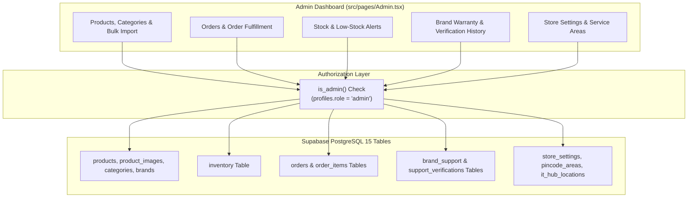

# Phase 7: Full Admin Dashboard Database Integration

**Status**: Planned  
**Target Milestone**: Comprehensive migration of all administrative panels from `localStorage` mock data to authenticated, role-verified Supabase database queries.

---

## 1. Objectives & Scope

- **Objective 1**: Connect catalog management, product creation, editing, and bulk CSV/XLSX imports to Supabase.
- **Objective 2**: Connect order processing, status updates (`Confirmed` $\rightarrow$ `Packed` $\rightarrow$ `Shipped` $\rightarrow$ `Delivered`), and cancellation management.
- **Objective 3**: Connect the Brand Support directory and official warranty verification audit logging.
- **Objective 4**: Enable administrative control over store settings, physical service areas, and PIN codes.

---

## 2. Technical Architecture

---

## 3. Implementation Tasks

### Task 7.1: Live Catalog Management & Bulk Import

- Connect [`src/pages/Admin.tsx`](file:///d:/mario/IT%20HUB/ITHUB_WEB/src/pages/Admin.tsx) Products tab to execute authenticated `INSERT`, `UPDATE`, and `DELETE` on `products`.
- Connect the multi-step SheetJS (`xlsx`) bulk import wizard to:
  1. Parse Excel / CSV files in the browser.
  2. Validate columns against database schema.
  3. Upsert products into `products` and initialize stock in `inventory`.
  4. Log the import batch in `import_runs`.

### Task 7.2: Order Management & Fulfillment Pipeline

- Order table displays live orders queried with customer details (`profiles`) and delivery addresses (`addresses`).
- Status transition actions:
  - Mark Packed $\rightarrow$ updates status to `'Packed'`.
  - Mark Shipped $\rightarrow$ adds courier tracking number and updates status to `'Shipped'`.
  - Mark Delivered $\rightarrow$ updates status to `'Delivered'`.
- Cancellation: Admin can cancel orders, which invokes `cancel_order(...)` RPC to atomically restore reserved inventory.

### Task 7.3: Brand Support & Warranty Verification History

- Brand support cards management (add/edit official customer care numbers, warranty portals, support emails).
- Official verification flow:
  - Admin verifies numbers against manufacturer website.
  - Generates audit entry in `support_verifications` with timestamp, source URL, and administrator name.

### Task 7.4: Store Settings & Service Radius

- Administrators can update store address, phone numbers, delivery region, and official WhatsApp number in `store_settings`.
- Dynamic on-site service radius adjustments (e.g. 15 km $\rightarrow$ 30 km) and PIN code coverage in `pincode_areas`.

---

## 4. Verification Checkpoints

| Feature                 | Verification Method                                                            |
| :---------------------- | :----------------------------------------------------------------------------- |
| **Admin Protection**    | Non-admin user attempting mutation $\rightarrow$ rejected by RLS               |
| **Product Upsert**      | Edit price in Admin $\rightarrow$ immediately reflected on customer storefront |
| **Order Status Update** | Update order to 'Shipped' $\rightarrow$ live tracking page updates             |
| **Bulk Import**         | Upload 50-item CSV $\rightarrow$ verify 50 products and inventory rows created |
