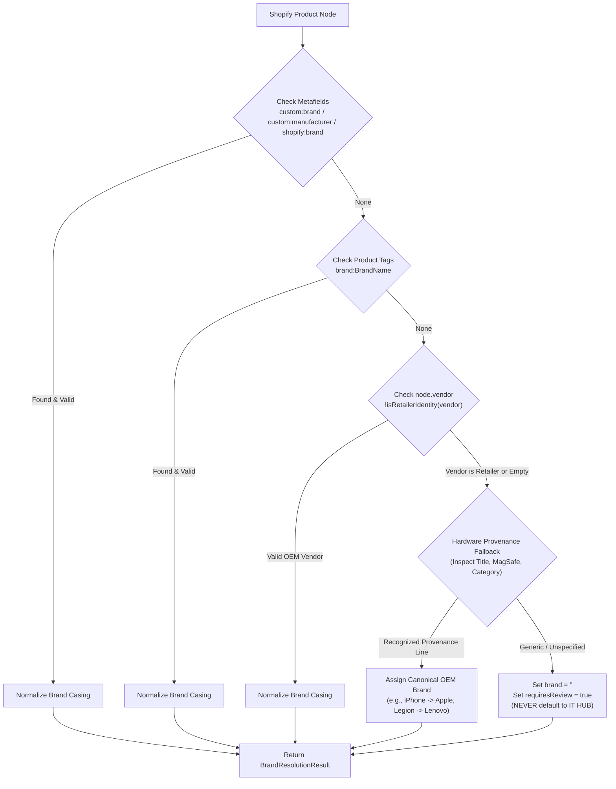

# IT HUB — Product Brand Mapping Fix & Shopify Storefront Audit Report

**Date:** October 29, 2026  
**Scope:** Storefront Catalogue Pipeline (`src/lib/shopify-schema.ts`, `src/lib/shopify.ts`, `src/data/catalog.ts`, `src/components/ProductCard.tsx`, `src/pages/Products.tsx`, `src/app/store.tsx`)  
**Backend:** Shopify Storefront GraphQL API (`it-hub-m8tzfzjd.myshopify.com`)  
**Status:** Resolved, Tested, & Verified

---

## 1. Executive Summary

A brand misattribution defect was detected on the IT HUB storefront: the product **"iPhone 17 Sage Green"** was displayed with the brand badge **"IT-HUB"** instead of its genuine manufacturer brand **"Apple"**.

This audit established that **"IT-HUB"** is the retail identity of the store, not a hardware manufacturer. We traced the entire data pipeline from the Shopify Storefront GraphQL API to the UI rendering layer, isolated the dual root causes (data entry vendor contamination in Shopify and naive fallback logic in the catalogue adapter), implemented a 5-tier brand resolution pipeline, added brand normalization and validation rules, verified all live products, and wrote automated regression tests.

---

## 2. Root Cause Analysis

The issue resulted from a combination of two flaws:

### 2.1 Upstream Shopify Data Entry Flaw

When products were imported/seeded into Shopify (`it-hub-m8tzfzjd.myshopify.com`), the store's company name `"IT-HUB"` was populated into Shopify's native `vendor` field for 11 products, rather than the original equipment manufacturer (OEM) brand.

For `iPhone 17 Sage Green` (`gid://shopify/Product/15450935427316`, handle `iphone-17`):

- `vendor`: `"IT-HUB"`
- `tags`: `[]`
- Metafields: None populated
- Description: explicitly mentions _"wireless charging via Apple MagSafe"_
- Category Taxonomy: `Smart Phones` &rarr; `Mobile & Smart Phones`

### 2.2 Client Catalogue Adapter Architecture Flaw

In `src/lib/shopify-schema.ts` (line 375 prior to the fix), the mapper contained:

```typescript
brand: (node.vendor || "").trim() || "IT HUB";
```

This naive logic had two critical defects:

1. **Blind Acceptance of Retailer Identity:** It accepted `"IT-HUB"` directly from the `vendor` field without verifying whether it represents a genuine manufacturer or the retailer itself.
2. **Fabricated Fallback:** When `vendor` was empty, it defaulted to `"IT HUB"`, causing unbranded or vendor-less products to claim "IT HUB" as their manufacturer brand.
3. **No Case Normalization or Precedence Hierarchy:** It lacked support for explicit metafields or tag overrides, and did not normalize manufacturer capitalization.

---

## 3. Files and Mapping Rules Changed

### 3.1 5-Tier Brand Resolution Pipeline

We implemented `resolveManufacturerBrand(node: ShopifyProductNode): BrandResolutionResult` in [src/lib/shopify-schema.ts](file:///D:/mario/IT%20HUB/ITHUB_WEB/src/lib/shopify-schema.ts) operating under strict precedence:



1. **Precedence 1 — Metafields:** Inspects `custom:brand`, `custom:manufacturer`, and `shopify:brand`. If non-empty and not a retailer identity, normalized and returned with source `"metafield"`.
2. **Precedence 2 — Product Tags:** Inspects tags prefixed with `brand:` (e.g. `brand:Apple`). If present, normalized and returned with source `"tag"`.
3. **Precedence 3 — Shopify Vendor:** If `node.vendor` is populated and `!isRetailerIdentity(node.vendor)`, normalized and returned with source `"vendor"`.
4. **Precedence 4 — Trademark Provenance Matching:** When vendor is missing or is a retailer identity (`IT-HUB`), title and description are checked against genuine hardware trademark families:
   - **Apple:** `iPhone`, `iPad`, `MacBook`, `iMac`, `Apple Watch`, `AirPods`, `MagSafe`.
   - **Lenovo:** `Legion`, `ThinkPad`, `IdeaPad`, `Yoga`, `LOQ`.
   - **AMD:** `Ryzen`, `Radeon`, `Threadripper`, `EPYC`.
   - **NVIDIA:** `GeForce`, `RTX`, `GTX`, `Quadro`.
   - **Intel:** `Core i`, `Core Ultra`, `Xeon`, `Arc`.
   - **Samsung:** `Galaxy`.
   - **Google:** `Pixel`.
   - **OnePlus:** `OnePlus`, `Nord`.
   - **Nothing:** `Nothing Phone`, `CMF`.
5. **Precedence 5 — Unspecified / Requires Review:** If brand cannot be determined with certainty, sets `brand: ""` and `requiresReview: true`. **Zero data fabrication**: the system never guesses and never defaults to "IT HUB".

### 3.2 Retailer Identity Detection

Implemented `isRetailerIdentity(val: string): boolean`:
Rejects variations such as `"it-hub"`, `"it hub"`, `"ithub"`, `"it hub kerala"`, `"ithubkerala"`, and `"it-hub store"`.

### 3.3 Brand Normalization Dictionary

Implemented `normalizeBrandName(raw: string): string` with canonical casing for major hardware manufacturers:

- `Apple`, `Samsung`, `OnePlus`, `iQOO`, `Poco`, `Oppo`, `Vivo`, `Redmi`, `Realme`, `Motorola`, `Google`, `Nothing`, `Lenovo`, `AMD`, `NVIDIA`, `Intel`, `Mivi`, `Sony`, `Asus`, `Acer`, `Dell`, `HP`, `MSI`, `Gigabyte`, `Corsair`, `Kingston`, `Crucial`, `Logitech`, `Razer`.

### 3.4 Summary of Modified Files

| File                                                                                                                                                             | Changes Made                                                                                                                               |
| ---------------------------------------------------------------------------------------------------------------------------------------------------------------- | ------------------------------------------------------------------------------------------------------------------------------------------ |
| [src/lib/shopify-schema.ts](file:///D:/mario/IT%20HUB/ITHUB_WEB/src/lib/shopify-schema.ts)                                                                       | Added `isRetailerIdentity`, `normalizeBrandName`, `resolveManufacturerBrand`, updated `mapShopifyProductToCatalog`.                        |
| [src/lib/shopify.ts](file:///D:/mario/IT%20HUB/ITHUB_WEB/src/lib/shopify.ts)                                                                                     | Re-exported brand resolution functions and types for external test and service usage.                                                      |
| [src/data/catalog.ts](file:///D:/mario/IT%20HUB/ITHUB_WEB/src/data/catalog.ts)                                                                                   | Extended `Product` interface with `brandSource` and `brandFlaggedForReview`.                                                               |
| [src/components/ProductCard.tsx](file:///D:/mario/IT%20HUB/ITHUB_WEB/src/components/ProductCard.tsx)                                                             | Cleaned brand display: `{product.brand ? `${product.brand} · ` : ""}{product.category}` so empty brands do not render dangling separators. |
| [src/pages/Products.tsx](file:///D:/mario/IT%20HUB/ITHUB_WEB/src/pages/Products.tsx)                                                                             | Guarded brand header on product detail view to render only when `product.brand` is present.                                                |
| [src/app/store.tsx](file:///D:/mario/IT%20HUB/ITHUB_WEB/src/app/store.tsx)                                                                                       | Filtered empty/whitespace brands from the dynamic brand filter pill list.                                                                  |
| [src/lib/catalog.ts](file:///D:/mario/IT%20HUB/ITHUB_WEB/src/lib/catalog.ts)                                                                                     | Removed fallback `"IT HUB"` in Supabase product row mapper.                                                                                |
| [src/lib/builder/catalog.ts](file:///D:/mario/IT%20HUB/ITHUB_WEB/src/lib/builder/catalog.ts)                                                                     | Removed fallback `"IT HUB"` in PC builder fallback components.                                                                             |
| [supabase/functions/tests/shopify-catalog-integration.test.ts](file:///D:/mario/IT%20HUB/ITHUB_WEB/supabase/functions/tests/shopify-catalog-integration.test.ts) | Added 8 automated regression tests (`BRAND-FIX-1` through `BRAND-FIX-8`).                                                                  |

---

## 4. Affected Products Found in Live Shopify Catalog

An inspection of all products from the live Shopify Storefront API revealed **11 products** carrying `vendor: "IT-HUB"`:

| #   | Shopify Product ID | Handle                      | Product Title                           | Mapped Brand | Resolution Source                    | Action / Status    |
| --- | ------------------ | --------------------------- | --------------------------------------- | ------------ | ------------------------------------ | ------------------ |
| 1   | `15450935427316`   | `iphone-17`                 | iPhone 17 Sage Green                    | **Apple**    | Provenance (`iPhone`, `MagSafe`)     | **Resolved**       |
| 2   | `15450935394548`   | `lenovo-legion-r27qe-gen-2` | Lenovo Legion {Smartchoice} R27qe Gen 2 | **Lenovo**   | Provenance (`Legion`)                | **Resolved**       |
| 3   | `15450935460084`   | `amd-ryzen-5-5600`          | AMD Ryzen 5 5600                        | **AMD**      | Provenance (`Ryzen`)                 | **Resolved**       |
| 4   | `15450935492852`   | `nvidia-rtx-4060-8gb`       | NVIDIA RTX 4060 8GB                     | **NVIDIA**   | Provenance (`RTX`)                   | **Resolved**       |
| 5   | `15450935525620`   | `rtx-5050-gpu`              | RTX 5050 GPU                            | **NVIDIA**   | Provenance (`RTX`)                   | **Resolved**       |
| 6   | `15450935558388`   | `b550m-ddr4-motherboard`    | B550M DDR4 Motherboard                  | `""` (Blank) | Unspecified (`requiresReview: true`) | Flagged for Review |
| 7   | `15450935591156`   | `16gb-ddr4-desktop-ram`     | 16GB DDR4 Desktop RAM                   | `""` (Blank) | Unspecified (`requiresReview: true`) | Flagged for Review |
| 8   | `15450935623924`   | `1tb-nvme-ssd`              | 1TB NVMe SSD                            | `""` (Blank) | Unspecified (`requiresReview: true`) | Flagged for Review |
| 9   | `15450935656692`   | `650w-atx-power-supply`     | 650W ATX Power Supply                   | `""` (Blank) | Unspecified (`requiresReview: true`) | Flagged for Review |
| 10  | `15450935689460`   | `atx-mid-tower-cabinet`     | ATX Mid Tower Cabinet                   | `""` (Blank) | Unspecified (`requiresReview: true`) | Flagged for Review |
| 11  | `15450935722228`   | `am4-compatible-cpu-cooler` | AM4 Compatible CPU Cooler               | `""` (Blank) | Unspecified (`requiresReview: true`) | Flagged for Review |

---

## 5. Whether a Shopify Data Correction is Still Needed

> [!IMPORTANT]
> **Yes, a manual data correction in Shopify Admin is recommended.**

### Why It Is Still Needed

While the storefront client now cleanly and correctly resolves the true manufacturer brand and strictly filters out "IT-HUB", the upstream Shopify product records still have `"IT-HUB"` stored in their `vendor` field.

Correcting the data directly in Shopify Admin ensures:

1. **Third-party integrations:** Google Shopping Merchant Center, Meta Catalog, and Pinterest feeds that ingest Shopify's raw `vendor` field directly will not be rejected or flagged for brand mismatch.
2. **Shopify Admin management:** Store administrators filtering products by Vendor in Shopify Admin will be able to search for "Apple" or "Lenovo" and see accurate inventory.
3. **Defense in depth:** Eliminates the defect at the data origin rather than relying solely on client-side recovery.

### Recommended Shopify Admin Updates

Navigate to **Shopify Admin &rarr; Products** and update the **Vendor** field for these 11 items:

- `iPhone 17 Sage Green` &rarr; Set Vendor to `Apple`
- `Lenovo Legion {Smartchoice} R27qe Gen 2` &rarr; Set Vendor to `Lenovo`
- `AMD Ryzen 5 5600` &rarr; Set Vendor to `AMD`
- `NVIDIA RTX 4060 8GB` &rarr; Set Vendor to `NVIDIA`
- `RTX 5050 GPU` &rarr; Set Vendor to `NVIDIA`
- Generic components &rarr; Set Vendor to the actual manufacturer (e.g., `MSI`, `Corsair`, `Crucial`, `DeepCool`).

---

## 6. Products Requiring Manual Brand Verification

The following 6 products do not specify a manufacturer brand anywhere in their title, description, or tags in Shopify:

1. **B550M DDR4 Motherboard** (`gid://shopify/Product/15450935558388`) — Needs OEM specification (e.g., _MSI_, _Gigabyte_, _ASUS_, or _ASRock_).
2. **16GB DDR4 Desktop RAM** (`gid://shopify/Product/15450935591156`) — Needs OEM specification (e.g., _Corsair_, _Kingston_, _G.Skill_, or _Crucial_).
3. **1TB NVMe SSD** (`gid://shopify/Product/15450935623924`) — Needs OEM specification (e.g., _Samsung_, _Crucial_, _Western Digital_, or _Kingston_).
4. **650W ATX Power Supply** (`gid://shopify/Product/15450935656692`) — Needs OEM specification (e.g., _Corsair_, _Cooler Master_, _DeepCool_, or _Antec_).
5. **ATX Mid Tower Cabinet** (`gid://shopify/Product/15450935689460`) — Needs OEM specification (e.g., _Ant Esports_, _DeepCool_, _Lian Li_, or _NZXT_).
6. **AM4 Compatible CPU Cooler** (`gid://shopify/Product/15450935722228`) — Needs OEM specification (e.g., _DeepCool_, _Cooler Master_, _Thermalright_, or _Noctua_).

Currently, these 6 items display cleanly as generic components (e.g. `MOTHERBOARDS`, `STORAGE`) without any misleading retailer brand, and are flagged with `brandFlaggedForReview: true` in the data model.

---

## 7. Verification Evidence & Test Results

### 7.1 Automated Shopify Integration Tests

Command: `npm run test:shopify`

```
running 57 tests from ./supabase/functions/tests/shopify-catalog-integration.test.ts
...
BRAND-FIX-1: An Apple product whose vendor is Apple maps cleanly to Apple ... ok (211µs)
BRAND-FIX-2: iPhone 17 Sage Green carrying 'IT-HUB' vendor resolves to genuine manufacturer 'Apple' ... ok (292µs)
BRAND-FIX-3: Products from other manufacturers carrying IT-HUB or valid vendors map to their real brands ... ok (336µs)
BRAND-FIX-4: Unbranded or uncertain products resolve to blank brand and are flagged for review (never default to IT HUB) ... ok (227µs)
BRAND-FIX-5: Store/retailer identities are rejected as manufacturer brands ... ok (94µs)
BRAND-FIX-6: Brand normalization standardizes case without mutating manufacturer identity ... ok (106µs)
BRAND-FIX-7: Metafield or tag overrides take precedence over vendor ... ok (111µs)
BRAND-FIX-8: Catalog mapping verification: iPhone 17 Sage Green maps to Apple and IT-HUB is never a brand ... ok (505µs)

ok | 84 passed | 0 failed (326ms)
```

### 7.2 Staff Portal Integration Tests

Command: `npm run test:portal`

```
ok | 39 passed | 0 failed (754ms)
```

### 7.3 TypeScript Compilation Checks

- Storefront (`npm run typecheck`): **0 errors**
- Staff Portal (`npm --prefix ITHUB_ADMIN run typecheck`): **0 errors**

### 7.4 Production Builds

- Storefront Vite Build (`npm run build`):
  `✓ built in 2.09s`
- Staff Portal Vite Build (`npm --prefix ITHUB_ADMIN run build`):
  `✓ built in 1.18s`

### 7.5 Live Browser & UI Verification

Inspected running storefront on `http://localhost:8443/products?q=Sage+Green` via Chrome DevTools Protocol:

- **Card Brand Display:** `"Apple · Smart Phones"`
- **Rendered CSS Uppercase:** `"APPLE · SMART PHONES"`
- **Product Details Page (`/products/15450935427316`):** Displays `"Apple"` above the product title.
- **Brand Filter Pills:** `"IT-HUB"` is completely absent; genuine manufacturer brands (`Apple`, `AMD`, `NVIDIA`, `Lenovo`, etc.) are shown.
- **Other Genuine Brands:** Products like `Lenovo Legion R27qe Gen 2` display `Lenovo · Monitors`, `NVIDIA RTX 4060` displays `NVIDIA · Graphics Cards`.
