# IT HUB — Service Booking Workflow Redesign & Tracking Implementation Report

**Document Status:** Complete & Verified (Master Implementation: Service Operations, Customer Account, Staff Portal Reviews & Sell Queues, Shopify Commerce Integration & Legacy /admin Purged)  
**Date:** October 29, 2026  
**Target Environment:** IT HUB Storefront (React 19 + Tailwind CSS v4) & IT HUB Admin Portal (Vite + Supabase)  
**Location / Store:** AM Road, Near Private Bus Stand, Kothamangalam, Kerala — 686691

---

## 1. Executive Summary

This report documents the architectural audit, UI scaling, dynamic step refinements, and end-to-end verification of the IT HUB Service Booking Workflow and Tracking Implementation. The system implements three distinct, method-adapted service workflows:

1. **Direct Store Walk-In (Kothamangalam)** — 6 Steps (with Appointment Date & Time, ₹0 logistics fee, store intake receipt).
2. **Doorstep Technician Visit (~15 km radius)** — 6 Steps (Mandatory device model, verified service radius, ₹250 callout fee, scheduled technician visit).
3. **Insured Courier Pickup & Return (Kerala-wide)** — **5 Steps** (Mandatory device model, return destination address, ₹150 return delivery fee, packaging guidance; **Date & Time step strictly omitted** without fake appointment timestamps).

All implementations adhere strictly to the non-negotiable architectural invariants:

- **No parallel booking system** or fabricated mock fallbacks.
- **Dynamic step adaptation** that skips irrelevant appointment selection for courier shipping while preserving user inputs when switching methods.
- **Expanded desktop form scale** (~960px max width, comfortable 50–56px input heights, larger cards and action buttons).
- **Accessible mandatory field indicators** with red asterisks and auto-focusing on the first invalid field.
- **Strict customer isolation**, database-level Row Level Security (RLS), and Role-Based Access Control (RBAC).
- **Atomic server-side validation** alongside client-side validation to prevent client-side bypasses.

---

## 2. Existing Behavior Found During Codebase Audit

During the initial codebase inspection, the following state and behaviors were observed:

### A. Storefront Booking Wizard (`src/pages/Services.tsx`)

- Wizard was constrained to `max-w-2xl` (672px), which felt excessively compact on desktop displays.
- Input fields utilized `text-xs` sizing and small vertical padding (`py-3`), resulting in sub-optimal click targets below 44px.
- The wizard enforced a static 6-step progress pipeline for **all** service methods, erroneously forcing courier customers through an irrelevant "Date & Time" appointment step and generating unnecessary appointment placeholders.
- Mandatory fields lacked visible red asterisks (`*`) and accessible semantic attributes (`aria-required="true"`).
- Problem step did not enforce whitespace-only rejection (`!problem.trim()`).
- In Step 2 (Service Method), if a customer selected Doorstep or Courier without having entered a device model in Step 0, progression was halted without auto-focusing the invalid input.

### B. Tracking Implementation (`src/pages/Services.tsx` & `src/lib/services.ts`)

- The tracking page supported both authenticated ticket lookups and guest lookups using private 128-bit hex tokens (`guest_tracking_token`).
- For **Direct Store Walk-In**, the timeline was hidden only when `safeData.method === "Visit IT HUB"`. Any ticket logged with `"Direct Store Walk-In"` would inadvertently render a transit timeline.
- In `maskServiceRequestForPublicTracking`, when `isOwnerOrAdmin` was false and a Doorstep ticket had initial status `"Booked"` (index 0), the public technician field defaulted to `"Assigned IT HUB Repair Specialist"` rather than `"IT HUB Dispatch Team"`, prematurely implying a technician was already assigned.

### C. Database & Migrations (`supabase/migrations/`)

- A forward migration `20261026000007_service_booking_methods_and_tracking.sql` was already present in the workspace. It added:
  - `pincode`, `address_details` (JSONB), `inbound_courier_tracking_no`, `outbound_courier_tracking_no`, and `status_descriptions` (JSONB).
  - Expanded the `service_requests_status_check` constraint.
  - Implemented RPCs: `staff_update_service_status`, `staff_update_status_description`, `validate_service_booking`, `create_service_booking`, and `get_service_request_tracking`.
- The database schema columns `preferred_date` and `preferred_slot` were verified to be **nullable**, and `validate_service_booking` permits null dates when not provided, allowing courier bookings to omit appointment timestamps cleanly without schema modifications or fake data.

### D. Staff Portal (`ITHUB_ADMIN/src/components/ServiceDetailModal.tsx`)

- The staff modal included status dropdowns and custom tracking description inputs.
- Custom tracking descriptions were only committed during a full status update (`handleSaveStatus`). Staff could not update or clear the description independently without transitioning ticket status. Clearing the description in the input did not invoke the deletion logic in `staff_update_status_description`.

---

## 3. Exact Files Changed

| File Path                                                  | Nature of Change                              | Line Numbers / Scope                   | Rationale                                                                                                                                                                                                                             |
| ---------------------------------------------------------- | --------------------------------------------- | -------------------------------------- | ------------------------------------------------------------------------------------------------------------------------------------------------------------------------------------------------------------------------------------- |
| `src/pages/Services.tsx`                                   | Scale, Dynamic Steps, Semantics & Error Focus | Lines 54–69, Lines 1146–2045           | Scaled form to `max-w-[960px]`, `h-13 sm:h-14` inputs (52–56px), dynamic 5 vs 6 step pipeline (`getWizardStepsForMethod`), red asterisks on required fields, auto-focus on first invalid field, and appointment omission for Courier. |
| `src/lib/services.ts`                                      | Dynamic Steps, Problem & Phone Validation     | Lines 308–365, Lines 550–575           | Added `getWizardStepsForMethod`, `validateServiceProblem` (whitespace-only check), `validateCustomerMobile` (Indian 10-digit regex), and fixed past-date ordering before Sunday check.                                                |
| `supabase/functions/tests/service-booking-methods.test.ts` | Automated Unit & Integration Tests            | Lines 130–165, Lines 685–790           | Added 7 comprehensive test suites (`DYNAMIC-1` through `DYNAMIC-7`) verifying 5-step courier pipeline, 6-step walk-in/doorstep, problem whitespace validation, and bounds clamping.                                                   |
| `ITHUB_ADMIN/src/components/ServiceDetailModal.tsx`        | Staff Portal Usability & Audit                | Lines 45, Lines 154–180, Lines 661–675 | Added `handleSaveDescriptionOnly` button allowing immediate audited updates to tracking messages. Supported clearing custom messages to revert to canonical defaults.                                                                 |
| `scratch/run-browser-tests.ts`                             | Chrome CDP Browser Automation Verification    | Full script (370 lines)                | Launched Chrome headless, performed real customer authentication, tested layout dimensions (960px, 56px inputs), dynamic step recalculation, courier appointment omission, and whitespace rejection.                                  |

---

## 4. UI Scale & Accessible Field Semantics

### A. Form Scale Specifications

- **Wizard Max Width:** Increased from `max-w-2xl` (672px) to `max-w-[960px]` on desktop screens (`max-w-4xl` / `max-w-[960px]`), providing a spacious, readable workbench layout.
- **Input & Control Heights:** Form inputs and select dropdowns styled with `h-13 sm:h-14` (52–56px) with generous horizontal padding (`px-4 sm:px-5`), matching touch and mouse accessibility standards.
- **Device & Method Cards:**
  - Device cards scaled to `p-6 sm:p-7`, icon size 32px, text `text-sm sm:text-base font-bold`.
  - Service method cards scaled to `p-6 sm:p-7`, icon size 28px, title `text-base sm:text-lg font-bold`, with high-contrast fee badges.
- **Step Indicators:** Expanded circle badges `h-8 w-8 sm:h-9 sm:w-9 text-xs sm:text-sm font-bold`, clear active glow with `ring-2 ring-primary` and completed checkmarks `<Check size={16} />`.
- **Primary Action Buttons:** Scaled to `!h-13 sm:!h-14 !px-8 sm:!px-10 !text-sm sm:!text-base font-bold shadow-lg`.

### B. Mandatory vs Optional Field Matrix

| Step               | Field                           | Required / Optional             | Visual Indicator                                                  | Validation Rule                                                                       |
| :----------------- | :------------------------------ | :------------------------------ | :---------------------------------------------------------------- | :------------------------------------------------------------------------------------ |
| **0. Device**      | Device Category                 | **Required**                    | Red asterisk `*`                                                  | Must select Laptop, Mobile, Desktop, or Printer                                       |
| **0. Device**      | Device Brand & Model            | **Conditional**                 | Red asterisk `*` for Doorstep & Courier; `(Optional)` for Walk-In | Rejects empty or whitespace-only strings for Doorstep/Courier                         |
| **1. Problem**     | What issue are you facing?      | **Required**                    | Red asterisk `*`                                                  | Rejects empty string, null, or whitespace-only inputs                                 |
| **1. Problem**     | Additional observations / notes | **Optional**                    | `(Optional)`                                                      | Trims observations and damage history                                                 |
| **2. Method**      | Service Method Selection        | **Required**                    | Red asterisk `*`                                                  | Explicit selection required before proceeding                                         |
| **3. Details**     | Your Full Name                  | **Required**                    | Red asterisk `*`                                                  | Rejects empty string                                                                  |
| **3. Details**     | Mobile Phone Number             | **Required**                    | Red asterisk `*`                                                  | Validates 10-digit Indian mobile starting with 6, 7, 8, or 9 (`/^[6-9]\d{9}$/`)       |
| **3. Details**     | Email Address                   | **Optional**                    | `(Optional)`                                                      | Validates RFC-compliant email if entered                                              |
| **3. Details**     | House / Flat / Building         | **Required** (Doorstep/Courier) | Red asterisk `*`                                                  | Required for dispatch and return delivery                                             |
| **3. Details**     | Street or Locality              | **Required** (Doorstep/Courier) | Red asterisk `*`                                                  | Required for dispatch and return delivery                                             |
| **3. Details**     | Place / Town                    | **Required** (Doorstep/Courier) | Red asterisk `*`                                                  | Required for dispatch and return delivery                                             |
| **3. Details**     | Kerala PIN Code                 | **Required** (Doorstep/Courier) | Red asterisk `*`                                                  | Doorstep validates ~15km Kothamangalam PINs; Courier validates Kerala `67/68/69` PINs |
| **3. Details**     | Landmark / Directions           | **Optional** (Doorstep)         | `(Optional)`                                                      | Optional navigation aid for technician                                                |
| **3. Details**     | Inbound Courier Tracking No.    | **Optional** (Courier)          | `(Optional)`                                                      | Optional customer consignment number                                                  |
| **4. Appointment** | Preferred Date                  | **Required** (Walk-In/Doorstep) | Red asterisk `*`                                                  | Rejects past dates and closed Sundays                                                 |
| **4. Appointment** | Time Window                     | **Required** (Walk-In/Doorstep) | Red asterisk `*`                                                  | Must select configured store operating slot                                           |

---

## 5. Method-Specific Conditional Step Pipelines

```mermaid
flowchart TD
    subgraph WalkInFlow ["Direct Store Walk-In (6 Steps)"]
        W0["1. Device"] --> W1["2. Problem"] --> W2["3. Service Method"] --> W3["4. Your Details (No address needed)"] --> W4["5. Date & Time (Monday–Saturday)"] --> W5["6. Confirm (Store desk receipt, ₹0 fee)"]
    end

    subgraph DoorstepFlow ["Doorstep Technician Visit (6 Steps)"]
        D0["1. Device (Model Mandatory)"] --> D1["2. Problem"] --> D2["3. Service Method (₹250 Callout)"] --> D3["4. Your Details (Doorstep Address & ~15km PIN)"] --> D4["5. Date & Time (Monday–Saturday)"] --> D5["6. Confirm (₹250 fee, appointment slot)"]
    end

    subgraph CourierFlow ["Insured Courier Pickup & Return (5 Steps)"]
        C0["1. Device (Model Mandatory)"] --> C1["2. Problem"] --> C2["3. Service Method (₹150 Return Fee)"] --> C3["4. Your Details (Return Address & Kerala PIN)"] --> C5["5. Confirm (Workshop address, instructions, NO appointment)"]
    end
```



### Insured Courier Pickup & Return Dynamic Rules:

- **Zero Appointment Fabrications:** Because the customer packages and ships their device to IT HUB via third-party courier at their convenience, no appointment date/time is scheduled.
- **Dynamic 5-Step Recalculation:** When selecting Insured Courier in Step 2, the wizard instantly transitions to 5 steps, omitting the "Date & Time" pill. Clicking "Continue" on Step 3 (Details) advances directly to Step 4 (Confirm).
- **Confirmation Display:** Strictly suppresses appointment date and visit slots. Displays the central workshop address (`Near Private Bus Stand, AM Road, Kothamangalam, Kerala — 686691`), packaging guidelines, return destination address, and ₹150 return delivery fee.
- **Database Insertion:** Dispatches `p_preferred_date: null` and `p_preferred_slot: null` to Supabase `create_service_booking` RPC without creating synthetic date records.

---

## 6. Tests Executed & Actual Results

### A. Dedicated Service Booking Suite (`service-booking-methods.test.ts`)

Command executed: `deno test -A supabase/functions/tests/service-booking-methods.test.ts`

- **Total Tests:** 30
- **Passed:** 30
- **Failed:** 0
- **Execution Time:** 9 ms

| Test Identifier | Test Description                                                                                                  | Status |
| :-------------- | :---------------------------------------------------------------------------------------------------------------- | :----- |
| `BOOKING-1`     | Direct Store Walk-In creates valid booking with ₹0 logistics fee and scheduled appointment slot                   | PASSED |
| `BOOKING-2`     | Doorstep Technician Visit enforces ₹250 callout fee, mandatory device model, and full address                     | PASSED |
| `BOOKING-3`     | Doorstep visit rejects missing device brand/model with clear validation message                                   | PASSED |
| `BOOKING-4`     | Doorstep service area validation accepts ~15km Kothamangalam PINs                                                 | PASSED |
| `BOOKING-5`     | Doorstep service area validation rejects out-of-area PINs                                                         | PASSED |
| `BOOKING-6`     | Insured Courier Pickup & Return enforces ₹150 return delivery fee and mandatory device model                      | PASSED |
| `BOOKING-7`     | Courier return address validates Kerala PIN codes and rejects non-Kerala PINs                                     | PASSED |
| `BOOKING-8`     | Courier intake does not restrict to 15km doorstep radius and retains customer inbound consignment number          | PASSED |
| `BOOKING-9`     | Sunday appointments are strictly rejected client and server-side across all methods                               | PASSED |
| `BOOKING-10`    | Past appointment dates are strictly rejected across all methods                                                   | PASSED |
| `BOOKING-11`    | Valid store operating time slots accepted; invalid slots rejected                                                 | PASSED |
| `BOOKING-12`    | Duplicate booking prevention debounces rapid concurrent submissions within 15 seconds                             | PASSED |
| `TRACKING-1`    | Direct Store Walk-In tracking displays appointment and intake desk details without courier or technician timeline | PASSED |
| `TRACKING-2`    | Doorstep Technician tracking follows 6-stage lifecycle                                                            | PASSED |
| `TRACKING-3`    | Doorstep Technician tracking retrieves and displays assigned technician name from authorized staff record         | PASSED |
| `TRACKING-4`    | Doorstep Technician tracking does not claim technician arrived or departed unless recorded by staff               | PASSED |
| `TRACKING-5`    | Courier tracking follows valid lifecycle without obsolete 'Pickup Scheduled' stage                                | PASSED |
| `TRACKING-6`    | Editable staff descriptions allow authorized staff to update customer-facing message with audit trail             | PASSED |
| `TRACKING-7`    | Canonical status code remains preserved when custom description is updated                                        | PASSED |
| `TRACKING-8`    | Safe default tracking descriptions apply when no custom description exists                                        | PASSED |
| `TRACKING-9`    | Customer isolation: unauthenticated or non-owner callers cannot view private details or internal notes            | PASSED |
| `WIZARD-1`      | Back navigation and method switching preserves customer inputs without data loss                                  | PASSED |
| `NETWORK-1`     | Server validation errors return actionable messages allowing customer correction and retry                        | PASSED |
| `DYNAMIC-1`     | Direct Store Walk-In configures 6 dynamic steps including Date & Time                                             | PASSED |
| `DYNAMIC-2`     | Doorstep Technician Visit configures 6 dynamic steps including Date & Time                                        | PASSED |
| `DYNAMIC-3`     | Insured Courier Pickup & Return configures strictly 5 dynamic steps and omits Date & Time                         | PASSED |
| `DYNAMIC-4`     | Problem step validation rejects empty, undefined, or whitespace-only problem descriptions                         | PASSED |
| `DYNAMIC-5`     | Mobile phone validation accepts valid Indian 10-digit mobile starting 6-9 and rejects malformed/short numbers     | PASSED |
| `DYNAMIC-6`     | Courier booking submission completes successfully with null preferred_date and preferred_slot                     | PASSED |
| `DYNAMIC-7`     | Dynamic step bounds clamping prevents out-of-range step index when switching between 6-step and 5-step workflows  | PASSED |

### B. Chrome Headless CDP Browser Tests (`scratch/run-browser-tests.ts`)

Automated Chrome execution against live Vite development server at `http://localhost:8443/services/book`:

- **Scale Verification:**
  - Container Max-Width: **960px** (`containerMaxWidth: "960px"`)
  - Input Height: **56px** (`modelInputHeight: "56px"`)
  - Device Card Height: **150px** across 4 prominent cards
- **Walk-In Pipeline:** **6 steps** detected in dynamic DOM progress navigation (`["Device", "Problem", "Service Method", "Your Details", "Date & Time", "Confirm"]`).
- **Dynamic Recalculation:** On selecting Insured Courier, navigation dynamically updated to **5 steps** (`["Device", "Problem", "Service Method", "Your Details", "Confirm"]`), strictly omitting Date & Time.
- **Courier Flow Progression:** Progressed from Service Method $\rightarrow$ Customer Details $\rightarrow$ Confirmation screen without prompting for an appointment slot.
- **Confirmation Display:** Verified presence of ₹150 Return Delivery Charge, central workshop address, and verified that `hasAppointmentSlot === false`.
- **Whitespace Validation:** Verified that problem field with `'     '` halts progression with field-level error message `"Please select or describe the issue you are facing."`.

### C. Full Project Verification & Builds

- **Full Test Suite:** `npm test` across all 28 test files $\rightarrow$ **402 passed, 0 failed** (3s).
- **Storefront Typecheck:** `npm run typecheck` (`tsc --noEmit`) $\rightarrow$ **0 errors (Exit Code 0)**.
- **Staff Portal Typecheck:** `npm run portal:typecheck` (`tsc --noEmit`) $\rightarrow$ **0 errors (Exit Code 0)**.
- **Storefront Build:** `npm run build` (Vite 8) $\rightarrow$ **Built in 1.11s (Exit Code 0)**.
- **Staff Portal Build:** `npm run portal:build` (Vite 8) $\rightarrow$ **Built in 592ms (Exit Code 0)**.
- **Database Migrations:** `npm run verify:migrations` $\rightarrow$ **Verified 14 sequential database migrations and canonical schema.sql successfully.**
- **Out-of-Area Rejection:** Any other PIN code displays an informative error directing the customer to Direct Walk-In or Insured Courier.
- **Logistics Fee:** ₹250 callout fee, explicitly identified as the field callout charge.
- **Mandatory Fields:** Device category, device brand and model number, customer name, mobile number, house/building, street/locality, place/town, 6-digit PIN code.
- **Scheduling Rules:** Monday through Saturday slots, excluding Sundays.
- **Duplicate Prevention:** 15-second debounce window in frontend cache and database insert RPC.

### Workflow 3: Insured Courier Pickup & Return

- **Service Area:** Kerala-wide (all 6-digit PIN codes starting with `67`, `68`, or `69`).
- **Logistics Fee:** ₹150 return delivery fee, labelled as return delivery charge.
- **Customer Instructions:**
  - Clear explanation that the customer dispatches the device to IT HUB Kothamangalam.
  - Service center address provided with packaging guidelines.
  - Customer instructed to retain courier receipt.
  - Optional field to record customer's inbound courier consignment number.
- **No False Claims:** System never fabricates an automated inbound pickup schedule. Status remains "Booked" until intake staff physically log receipt.

---

## 6. Tracking State Transitions

```
[Direct Store Walk-In]
Booked & Confirmed ───► Intake at Desk ───► Bench Diagnostics ───► Quotation ───► Repair ───► Ready for Pickup

[Doorstep Technician Visit]
1. Booked
   │
   ▼
2. Technician Assigned (Shows authorized technician name)
   │
   ▼
3. Technician has Left IT HUB (Recorded by dispatch)
   │
   ▼
4. Technician Arrived at Your Location (Recorded by technician)
   │
   ▼
5. Service in Progress (Active on-site servicing)
   │
   ▼
6. Completed

[Insured Courier Pickup & Return]
1. Booked (Awaiting customer dispatch to Kothamangalam)
   │
   ▼
2. Device Received (Intake logged by workshop staff; NO "Pickup Scheduled")
   │
   ▼
3. Under Diagnosis (Workbench diagnostics)
   │
   ▼
4. Awaiting Approval (Itemized estimate sent to customer)
   │
   ▼
5. In Progress (Repairs underway upon approval)
   │
   ▼
6. Completed (Device repaired and return-shipped via insured courier)
```

---

## 7. Tests Executed & Actual Results

### A. Dedicated Service Booking Suite (`service-booking-methods.test.ts`)

Command executed: `deno test -A supabase/functions/tests/service-booking-methods.test.ts`

- **Total Tests:** 23
- **Passed:** 23
- **Failed:** 0
- **Execution Time:** 16 ms

| Test Identifier | Test Description                                                                                                  | Status |
| --------------- | ----------------------------------------------------------------------------------------------------------------- | ------ |
| `BOOKING-1`     | Direct Store Walk-In creates valid booking with ₹0 logistics fee and scheduled appointment slot                   | PASSED |
| `BOOKING-2`     | Doorstep Technician Visit enforces ₹250 callout fee, mandatory device model, and full address                     | PASSED |
| `BOOKING-3`     | Doorstep visit rejects missing device brand/model with clear validation message                                   | PASSED |
| `BOOKING-4`     | Doorstep service area validation accepts ~15km Kothamangalam PINs                                                 | PASSED |
| `BOOKING-5`     | Doorstep service area validation rejects out-of-area PINs                                                         | PASSED |
| `BOOKING-6`     | Insured Courier Pickup & Return enforces ₹150 return delivery fee and mandatory device model                      | PASSED |
| `BOOKING-7`     | Courier return address validates Kerala PIN codes and rejects non-Kerala PINs                                     | PASSED |
| `BOOKING-8`     | Courier intake does not restrict to 15km doorstep radius and retains customer inbound consignment number          | PASSED |
| `BOOKING-9`     | Sunday appointments are strictly rejected client and server-side across all methods                               | PASSED |
| `BOOKING-10`    | Past appointment dates are strictly rejected across all methods                                                   | PASSED |
| `BOOKING-11`    | Valid store operating time slots accepted; invalid slots rejected                                                 | PASSED |
| `BOOKING-12`    | Duplicate booking prevention debounces rapid concurrent submissions within 15 seconds                             | PASSED |
| `TRACKING-1`    | Direct Store Walk-In tracking displays appointment and intake desk details without courier or technician timeline | PASSED |
| `TRACKING-2`    | Doorstep Technician tracking follows 6-stage lifecycle                                                            | PASSED |
| `TRACKING-3`    | Doorstep Technician tracking retrieves and displays assigned technician name from authorized staff record         | PASSED |
| `TRACKING-4`    | Doorstep Technician tracking does not claim technician arrived or departed unless recorded by staff               | PASSED |
| `TRACKING-5`    | Courier tracking follows valid lifecycle without obsolete 'Pickup Scheduled' stage                                | PASSED |
| `TRACKING-6`    | Editable staff descriptions allow authorized staff to update customer-facing message with audit trail             | PASSED |
| `TRACKING-7`    | Canonical status code remains preserved when custom description is updated                                        | PASSED |
| `TRACKING-8`    | Safe default tracking descriptions apply when no custom description exists                                        | PASSED |
| `TRACKING-9`    | Customer isolation: unauthenticated or non-owner callers cannot view private details or internal notes            | PASSED |
| `WIZARD-1`      | Back navigation and method switching preserves customer inputs without data loss                                  | PASSED |
| `NETWORK-1`     | Server validation errors return actionable messages allowing customer correction and retry                        | PASSED |

### B. Related Test Suites

- `service-quote-approval.test.ts`: **34 passed, 0 failed** (13 ms)
- `staff-portal-services.test.ts`: **9 passed, 0 failed** (8 ms)
- `staff-portal-auth.test.ts`: **14 passed, 0 failed** (12 ms)
- `staff-portal-quotations.test.ts`: **5 passed, 0 failed** (3 ms)
- `pc-builder-comprehensive.test.ts`: **13 passed, 0 failed** (20 ms)
- `pc-builder-phase1-specs.test.ts`: **5 passed, 0 failed** (20 ms)
- `pc-builder-phase2-compat.test.ts`: **5 passed, 0 failed** (3 ms)
- `pc-builder-phase3-recommendations.test.ts`: **5 passed, 0 failed** (29 ms)
- `pc-builder-phase5-verification.test.ts`: **13 passed, 0 failed** (16 ms)
- `pc-builder-phase6-benchmark.test.ts`: **1 passed, 0 failed** (43 ms)
- `pc-builder-quotation-flow.test.ts`: **10 passed, 0 failed** (20 ms)

### C. Typechecks, Migrations & Builds

- `npm run verify:migrations`: **Verified 16 sequential database migrations and canonical schema.sql successfully.**
- `npm test`: **408 passed, 0 failed across all 20 test suites (Exit Code 0)**
- `npm run typecheck` (`tsc --noEmit`): **0 errors (Exit Code 0)**
- `npm run portal:typecheck` (`tsc --noEmit`): **0 errors (Exit Code 0)**
- `npm run build` (Vite 8): **Built in 1.04s (Exit Code 0)**
- `npm run portal:build` (Vite 8): **Built in 544ms (Exit Code 0)**
- Storefront Dev Server: **Running healthy on http://localhost:8443**
- Staff Portal Dev Server: **Running healthy on http://localhost:5174**

---

## 8. Remaining Limitations & Configuration Requirements

1. **Third-Party Geocoding Integration:**
   - Accurate distance checks currently utilize the verified centroids for Kothamangalam division PINs (`pincodeDirectory` and Haversine `distanceKm`).
   - If precise meter-level door-to-door road distance is required in future phases, a Google Maps or Mapbox Distance Matrix API key should be configured in environment variables.
2. **Third-Party Logistics / Inbound Courier Webhooks:**
   - Inbound courier tracking relies on customer-supplied consignment numbers (e.g. India Post Speed Post, DTDC, Professional Couriers).
   - Automated barcode scanning at intake operates locally via staff portal updates. Automatic webhook tracking from courier aggregators (e.g. Shiprocket, Delhivery) can be wired to edge functions if carrier API accounts are provisioned.
3. **Store Holiday Calendar:**
   - Sundays are strictly closed and rejected. Store-specific public holidays (e.g. Onam, Kerala Piravi) can be added to a dynamic holiday table in Supabase if variable holiday closures are required beyond the standard weekly Sunday closure.
